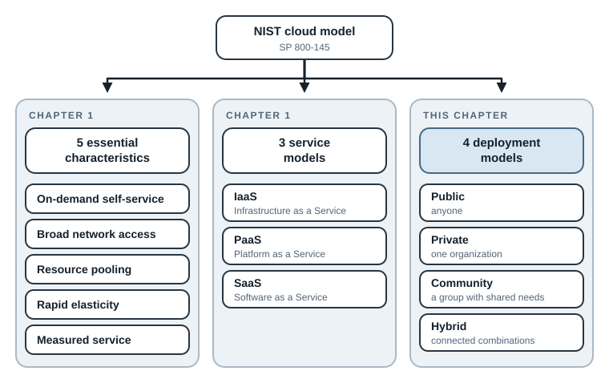

A developer needs a server for a new project. In a traditional company, that means a ticket to the
IT team, a purchase approval, and a few weeks of waiting for hardware to arrive, be racked, and be
installed. In a cloud, it means a few clicks or one command, and a server is running a minute later.
When the project ends, the developer deletes it and stops paying.

That difference is what people mean by cloud computing. The word "cloud" gets used for almost
anything on the internet, so this chapter starts from a precise definition, then explains the four
ways a cloud can be deployed.

This series doesn't teach one provider's console. It explains the ideas underneath AWS, Azure, and
Google Cloud, so the rest of what you learn has a frame to fit into. By the end of this chapter you
will be able to:

- give the standard definition of cloud computing and explain it in plain words;
- tell public, private, community, and hybrid clouds apart, and where multi-cloud fits;
- explain why a cloud is defined by how you get resources, and not by where the hardware sits.

## The Definition Everyone Uses

In September 2011, the US National Institute of Standards and Technology (NIST) published a short
document, *SP 800-145*, that defined cloud computing. Most of the industry, and most certification
courses, still refer to it:

> Cloud computing is a model for enabling ubiquitous, convenient, on-demand network access to a
> shared pool of configurable computing resources (e.g., networks, servers, storage, applications,
> and services) that can be rapidly provisioned and released with minimal management effort or
> service provider interaction.

In plain words, a cloud is:

- a shared pool of servers, storage, and networks, used by many customers;
- reached over the network, from anywhere;
- available on demand: you take resources when you need them and give them back when you don't;
- fast and hands-off: nobody at the provider has to do anything for your request to happen.

NIST then breaks the model into three groups: five *essential characteristics*, three *service
models*, and four *deployment models*. Chapter 1 covers the characteristics and service models.
This chapter covers the deployment models, which answer one question: *who* is the cloud for?

## What Makes Something a Cloud

A common mistake is to think "cloud" means "someone else's data center". It doesn't. A company can
run a cloud in its own building. And a rented server in someone else's data center isn't a cloud if
you still have to email the provider and wait a week for a new one.

What makes something a cloud is *how* you get resources: on demand, by yourself, from a shared pool,
with the usage measured. Who the cloud serves, and who owns the hardware, decides the *deployment
model*.

## The Four Deployment Models

### Public cloud

The provider owns the hardware and offers it to anyone who signs up. AWS, Microsoft Azure, and
Google Cloud are public clouds. Customers share the same physical infrastructure, but the provider
keeps each customer's resources and data isolated from the others.

Beyond raw servers, public clouds sell finished services. If your application needs Redis, you don't
install it on a server: you create an Amazon ElastiCache cluster, and AWS runs it. That catalog of
managed services is the main reason teams choose a public cloud.

- **Good for:** most new applications, teams that want to move fast, and workloads that grow and
  shrink.
- **Trade-off:** you depend on the provider's prices, limits, and availability, and you share
  responsibility for security with them. (Chapter 1 explains this *shared responsibility model*.)

### Private cloud

The cloud serves one organization only, with all its teams and business units. It can run in the
company's own data center or be hosted by a provider, but no other customer uses it. Teams still
request resources by themselves from a portal or API; the difference is that the pool belongs to one
company.

- **Good for:** strict rules on where data lives, existing data centers the company wants to keep
  using, and very steady workloads.
- **Trade-off:** when the cloud runs in its own data center, the company buys the hardware and runs
  the cloud software itself, so it needs the people and the money to do that well.

### Community cloud

A cloud shared by a group of organizations with the same needs, such as government agencies or
banks under the same regulations. It's the least common model, but it explains why some providers
offer separate cloud regions only for government customers.

- **Good for:** organizations that must meet the same rules and want to share the cost of a cloud
  that meets them.
- **Trade-off:** the members have to agree on how the cloud is run, secured, and paid for.

### Hybrid cloud

Two or more of the models above, connected so that applications and data can move between them. A
common example: a bank keeps its core banking system in its private cloud and runs its mobile app
back end in a public cloud, with a private network link between the two.

- **Good for:** moving to the cloud step by step, and keeping specific data on premises.
- **Trade-off:** two environments to run, secure, and connect.

### What about multi-cloud?

*Multi-cloud* isn't one of NIST's four models. It means using more than one public cloud, for example
AWS for the main application and Google Cloud for data analytics. Teams do it to use one provider's
strongest service, to meet a customer's requirement, or after an acquisition. It also multiplies the
work: two sets of accounts, networks, permissions, and bills.
[Chapter 2](/aws-cloud-computing-02-standards-organizations/) covers the standards that make moving
between clouds easier.

## When the Public Cloud Comes to Your Data Center

The line between public and private cloud is less sharp than it used to be. The big providers now
offer ways to run their cloud services on hardware inside the customer's data center: AWS Outposts,
Microsoft Azure Local, and Google Distributed Cloud. You manage these with the provider's own tools
and APIs, while the hardware and the data stay in your building. (Each product supports only part of
its provider's public cloud services, so check the list before you plan around one.)

This is useful when data must stay on premises, or when an application needs very low latency to
local systems, such as machines in a factory.

## Summary

- NIST's definition: on-demand network access to a shared pool of computing resources, provided
  quickly and with minimal effort from the provider.
- A cloud is a way of getting resources (on demand, self-service, shared, measured), not a location.
- Four deployment models: public (anyone), private (one organization), community (a group with
  shared needs), and hybrid (connected combinations). Multi-cloud means using several public clouds.
- Public cloud services can now run on hardware inside your own data center, managed with the
  provider's tools and APIs.

Next: [Chapter 1](/aws-cloud-computing-01-components-characteristics/) opens the cloud up: the shared
resource pool, the three service models (IaaS, PaaS, SaaS), and the five essential characteristics
every cloud must have.

## Resources

- [NIST SP 800-145: The NIST Definition of Cloud Computing](https://csrc.nist.gov/pubs/sp/800/145/final)
- [AWS Outposts](https://aws.amazon.com/outposts/)
