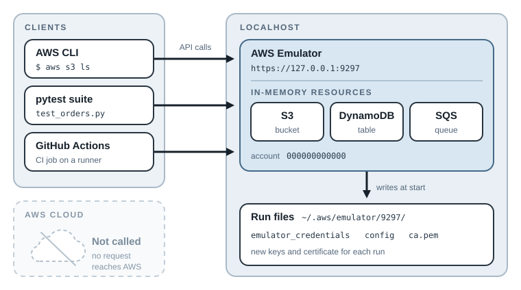
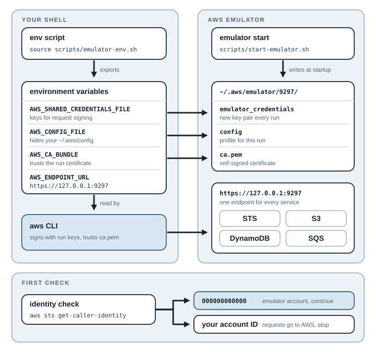
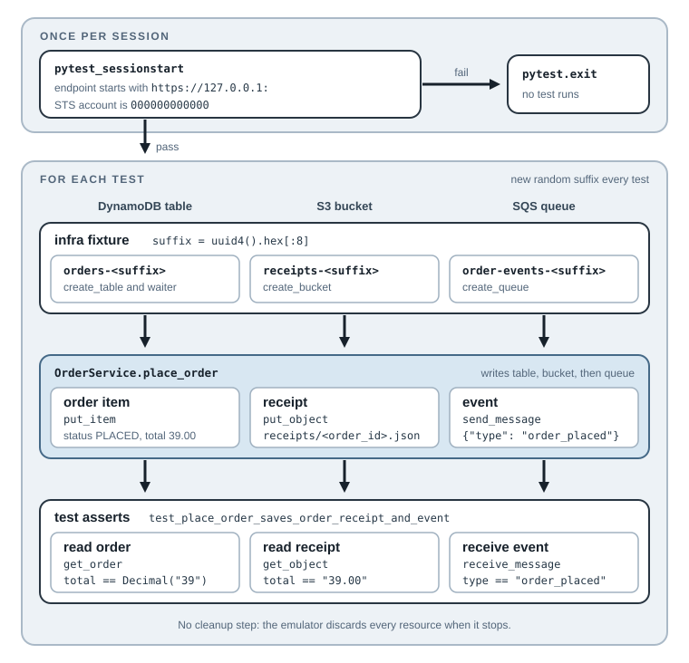
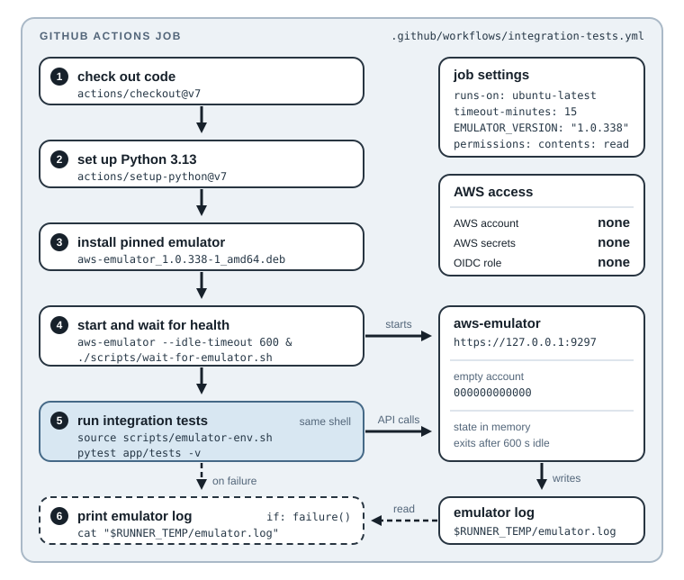

Code that calls AWS is hard to test. A unit test with a mocked boto3 client passes, then the
same code fails on AWS because the real API returns a different error code or normalizes a
value the mock passed through. Testing against a real account fixes that, but it brings its
own problems: every developer needs credentials, CI needs a secret or an OIDC role, tests
leave resources behind, and two pipelines that run at the same time can step on each other's
buckets.

AWS Emulator removes the account from that picture. It is a local program, published by AWS,
that serves the AWS APIs on `https://127.0.0.1:9297`. The AWS CLI and the AWS SDKs send their
requests to it instead of to AWS, and it keeps the resources you create in memory. You don't
need an AWS account, and it has no service fee.

This post sets it up and uses it for three jobs:

1. Learning the AWS CLI without touching a real account.
2. Testing application code that uses DynamoDB, S3, and SQS on your own machine.
3. Running the same tests in GitHub Actions with no AWS secrets.

Each case needs only the setup in [Start the Emulator](#start-the-emulator). If you only care
about CI, read that section and then skip to [Case 3](#case-3-run-integration-tests-in-ci).

> **Code for this post.** Everything is in
> [_resource/aws-emulator](https://github.com/VersusControl/devops-vn-blog/tree/main/_resource/aws-emulator).
> I tested it with AWS Emulator 1.0.338, AWS CLI 2.37.7, and boto3 1.44.2, on macOS through
> Docker and on Ubuntu 24.04 with the native package. Command output in this post comes from
> those runs.

## How AWS Emulator Works

AWS Emulator is one process that serves every AWS service it supports on one HTTPS endpoint.
It has no web console. You talk to it with the same tools you use for AWS, and the three
cases in this post all reach it the same way:



Three details explain most of its behavior.

- It uses one endpoint for every service. The SDKs and the CLI read the `AWS_ENDPOINT_URL`
  environment variable. When it points at the emulator, an S3 call and a DynamoDB call both
  go to `https://127.0.0.1:9297`, and the emulator works out the target service from the
  request. Your code does not change.
- It has its own credentials for each run. By default the emulator checks request signatures
  the way AWS does (*SigV4*, the AWS request-signing scheme). Each time it starts, it generates
  a new access key pair and writes it, a config file, and a self-signed certificate to
  `~/.aws/emulator/<port>/`. The keys work only with that run. The emulator rejects real AWS
  keys.
- State lives in memory. Buckets, tables, and queues exist until the process stops. A
  restart gives you an empty account. There is no reset API, so a restart is the reset.

Every resource belongs to one fake account, `000000000000`. That number is the quickest way
to check where your requests go, and the scripts in this post use it as a safety check.

You can run the emulator three ways:

| Mode | Platform | When to use it |
| --- | --- | --- |
| Native package (`.rpm` or `.deb`) | Linux x86_64 and aarch64 | Linux laptops and CI runners |
| Docker image you build | macOS, Windows, Linux | macOS and Windows, because there is no native package |
| Embedded mode | Rust tests only | Rust projects that want one emulator per test, in-process |

AWS does not publish a prebuilt container image. You build one from a short Dockerfile, shown
in the next section. Embedded mode compiles the whole emulator into your Rust test binary, and
the README asks for about 100 GB of disk for that build, so this post skips it.

### What the emulator does not do

Know the limits before you build a workflow on it. These come from the AWS Emulator user
guide:

- It does not test security. It does not evaluate IAM policies, bucket policies, or KMS key
  policies the way AWS does. A request signed with the emulator's own key is never denied, so
  a test that passes on the emulator says nothing about your permissions.
- One emulator is one account and one Region. It accepts any Region in a request but doesn't
  keep resources apart by Region. To test two Regions, run two emulators on two ports.
- Fidelity varies by service. AWS calls how closely the emulator matches AWS its
  *fidelity*. It is closest for *control plane* calls, the ones that create, describe, and
  delete resources. Support for *data plane* calls (reading and writing the data inside a
  resource) and for CloudFormation, Terraform, and CDK varies by service. An operation that
  isn't implemented yet returns HTTP 501 `NotImplemented`.
- It is built for test runs, not long-running use. AWS hasn't tested it for load testing or
  for staying up for days.

The repository tracks every known gap as a Markdown file under
[`issues/things-that-do-not-work/`](https://github.com/aws/aws-emulator/tree/main/issues/things-that-do-not-work).
When I looked, many of them were cross-service integrations, for example an EventBridge rule
that never invokes its Lambda target. Single-service calls to S3, DynamoDB, and SQS, which this
post uses, worked as expected. Each release also publishes per-service fidelity scores on the
[releases page](https://github.com/aws/aws-emulator/releases).

## Start the Emulator

On Linux, you can install the `.deb` or `.rpm` package and run `aws-emulator` directly. Case 3
shows the install commands for Ubuntu. On macOS and Windows, build a container image. This is
the Dockerfile from the user guide, with one build argument added so the same file works on
Intel and Arm machines:

```dockerfile
FROM public.ecr.aws/amazonlinux/amazonlinux:2023-minimal

ARG EMULATOR_ARCH=x86_64
ADD https://downloads.aws.com/aws-emulator/packages/aws-emulator/LTS/latest/aws-emulator-${EMULATOR_ARCH}.rpm /tmp/aws-emulator.rpm

RUN rpm -i /tmp/aws-emulator.rpm && rm /tmp/aws-emulator.rpm \
    && mkdir -p /home/emulator && chown 1000 /home/emulator

USER 1000
ENV HOME=/home/emulator
EXPOSE 9297

# -b 0.0.0.0 lets Docker forward the port. Publish it on 127.0.0.1 only.
ENTRYPOINT ["aws-emulator", "-b", "0.0.0.0"]
```

The image installs the latest LTS package at build time, so rebuild it when you want a newer
emulator. Build it and check the version. On Apple silicon, pass the Arm package name; on an
Intel or AMD machine, drop the `--build-arg`:

```sh
docker build --build-arg EMULATOR_ARCH=aarch64 -t aws-emulator .
docker run --rm aws-emulator -v
```

```text
Version: 1.0.338
Release date: 2026.11.12
Commit: 32b3cf39b49b34d906693dfa43539d42886b562b
```

> **Note:** If the build fails with `403 Forbidden` from `public.ecr.aws`, Docker is sending an
> expired login for that registry. Run `docker logout public.ecr.aws` and build again. The base
> image is public and needs no login.

Start the container with `scripts/start-emulator.sh` in its own terminal. It runs in the
foreground, and Ctrl+C stops it and deletes everything it holds. (On Windows, run the script
from WSL.) The important part is the `docker run` line:

```sh
mkdir -p "$HOME/.aws/emulator"

docker run --rm \
  --memory=2g --memory-swap=2g \
  -p "127.0.0.1:9297:9297" \
  -e HOME="$HOME" -v "$HOME/.aws/emulator:$HOME/.aws/emulator" \
  aws-emulator -p 9297 --telemetry off
```

Each option has a reason:

- `-p 127.0.0.1:9297:9297` publishes the port on your machine only. The short form
  `-p 9297:9297` opens the emulator to your whole network.
- `-v` and `-e HOME` share `~/.aws/emulator` with the container at the same path, so the
  credentials and certificate the emulator writes are readable on your machine. On Linux the
  script also passes `--user` with your UID and GID, so those files belong to you and not to
  UID 1000.
- `--memory=2g` caps memory. The emulator idles at about 160 MiB and grows as tests create
  resources. If it reaches the limit, the container exits with code 137 and the resources are
  gone.
- `--telemetry off` turns off the anonymous usage data the emulator sends by default.

The emulator logs JSON lines. The one to look for is the startup line, which gives the
endpoint, the health check URL, and the paths of the files it just wrote:

```json
{"message":"emulator server information","endpoint_url":"https://127.0.0.1:9297",
 "health_check_url":"https://127.0.0.1:9297/__admin/health",
 "config_file":"/Users/you/.aws/emulator/9297/config",
 "ca_file":"/Users/you/.aws/emulator/9297/ca.pem", ...}
```

It also prints a warning that it listens on `0.0.0.0`. Inside the container that is expected:
Docker needs it to forward the port, and the `127.0.0.1` in `-p` keeps the port private.

### Point your shell at the emulator

The emulator is running, but your shell still talks to AWS. Source
`scripts/emulator-env.sh` in a second terminal:

```sh
source scripts/emulator-env.sh
```

The script changes only the current shell. It removes variables that hold real credentials
and sets these (shown for the default port 9297):

```sh
unset AWS_ACCESS_KEY_ID AWS_SECRET_ACCESS_KEY AWS_SESSION_TOKEN AWS_PROFILE AWS_BEARER_TOKEN_BEDROCK

export AWS_ENDPOINT_URL="https://127.0.0.1:9297"
export AWS_SHARED_CREDENTIALS_FILE="$HOME/.aws/emulator/9297/emulator_credentials"
export AWS_CONFIG_FILE="$HOME/.aws/emulator/9297/config"
export AWS_CA_BUNDLE="$HOME/.aws/emulator/9297/ca.pem"
export AWS_EC2_METADATA_DISABLED=true
export AWS_DISABLE_HOST_PREFIX_INJECTION=true
export AWS_REGION=us-east-1
export AWS_DEFAULT_REGION=us-east-1
export AWS_PAGER=""
export NODE_EXTRA_CA_CERTS="$AWS_CA_BUNDLE"
```

What the important ones do:

- `AWS_ENDPOINT_URL` sends every service call to the emulator.
- `AWS_SHARED_CREDENTIALS_FILE` and `AWS_CONFIG_FILE` load the keys and profile for this run.
  Setting `AWS_CONFIG_FILE` hides your own `~/.aws/config` for this shell only.
- `AWS_CA_BUNDLE` makes the CLI, boto3, and the Go SDK trust the emulator's self-signed
  certificate. The Node.js SDK ignores it and reads `NODE_EXTRA_CA_CERTS` instead, so the
  script sets that to the same file.
- `AWS_EC2_METADATA_DISABLED` stops the SDK from asking an EC2 instance for real credentials
  when you run tests on EC2.
- `AWS_DISABLE_HOST_PREFIX_INJECTION` stops the SDK from adding prefixes such as `data-` to
  the host name for some operations. A request to `data-127.0.0.1` never reaches the emulator.
- `AWS_PAGER=""` stops the CLI from piping output through `less`, which matters in scripts.

Keep `127.0.0.1` in the endpoint, not `localhost`. With an IP address, the SDKs put the S3
bucket name in the URL path. With `localhost`, the JavaScript, Java, and Go SDKs put it in the
host name, and the emulator rejects those requests.

## Case 1: Learn the AWS CLI Without an Account

Learning the AWS CLI on a real account has a cost even on the free tier: you need an IAM user,
you worry about a typo that creates something expensive, and you clean up by hand. Against the
emulator, the worst outcome of a mistake is a restart.



The diagram shows why sourcing the env script is enough: the CLI finds everything it needs in
the files the emulator wrote for this run. Run the commands below in the shell where you
sourced it. Start every session with the identity check:

```sh
aws sts get-caller-identity
```

```json
{
    "UserId": "AIDAH5I7GEMO7ADXNFAZU",
    "Account": "000000000000",
    "Arn": "arn:aws:iam::000000000000:user/emulator"
}
```

If you see your own account ID, your requests are going to AWS. Stop and source the env script
again.

### S3

Create a bucket, upload a file, list the bucket, and print the file:

```sh
echo "hello from the emulator" > hello.txt
aws s3 mb s3://devopsvn-lab
aws s3 cp hello.txt s3://devopsvn-lab/notes/hello.txt
aws s3 ls s3://devopsvn-lab --recursive
aws s3 cp s3://devopsvn-lab/notes/hello.txt -
```

```text
make_bucket: devopsvn-lab
upload: ./hello.txt to s3://devopsvn-lab/notes/hello.txt
2026-11-13 13:08:21         24 notes/hello.txt
hello from the emulator
```

The emulator also validates input. S3 bucket names can't contain uppercase letters or
underscores, so this fails:

```sh
aws s3 mb s3://Bad_Bucket
```

```text
make_bucket failed: s3://Bad_Bucket An error occurred (InvalidBucketName) when calling the CreateBucket operation: The specified bucket is not valid.
```

This is the same error code AWS returns, so you learn the rule from the error you would see in
production.

### DynamoDB

Create a table with `order_id` as its partition key, and wait for it to become active:

```sh
aws dynamodb create-table --table-name orders \
  --attribute-definitions AttributeName=order_id,AttributeType=S \
  --key-schema AttributeName=order_id,KeyType=HASH \
  --billing-mode PAY_PER_REQUEST \
  --query 'TableDescription.{Name:TableName,Status:TableStatus}'
aws dynamodb wait table-exists --table-name orders
```

```json
{
    "Name": "orders",
    "Status": "CREATING"
}
```

The table starts in `CREATING`, as it does on AWS. A script that writes immediately after
`create-table` fails on AWS, so practise the `wait` command here too.

Write an item, then try to write a second order with the same ID. The condition expression
makes the second write fail instead of overwriting the first:

```sh
aws dynamodb put-item --table-name orders \
  --item '{"order_id":{"S":"ord-001"},"customer":{"S":"alice"},"total":{"N":"42"}}'

aws dynamodb put-item --table-name orders \
  --item '{"order_id":{"S":"ord-001"},"customer":{"S":"bob"},"total":{"N":"1"}}' \
  --condition-expression 'attribute_not_exists(order_id)'
```

```text
An error occurred (ConditionalCheckFailedException) when calling the PutItem operation: The conditional request failed
```

The first `put-item` prints nothing on success. The second one fails, and alice's order is
still the one in the table. Case 2 uses the same condition in application code.

### SQS

Create a queue, send a message, and receive it:

```sh
queue_url=$(aws sqs create-queue --queue-name order-events --query QueueUrl --output text)
echo "$queue_url"
aws sqs send-message --queue-url "$queue_url" --message-body '{"order_id":"ord-001"}'
aws sqs receive-message --queue-url "$queue_url" --wait-time-seconds 1 --query 'Messages[].Body'
```

```text
https://sqs.us-east-1.amazonaws.com/000000000000/order-events
...
[
    "{\"order_id\":\"ord-001\"}"
]
```

The queue URL looks like a real AWS URL. That is fine: the CLI sends the request to
`AWS_ENDPOINT_URL` and passes the queue URL as a parameter, so nothing reaches
`sqs.us-east-1.amazonaws.com`.

`cli/learn-aws-cli.sh` in the sample runs all of these commands. It checks the account ID
first and exits if it isn't `000000000000`. It uses fixed names, so a second run fails on
resources that already exist. To start over, press Ctrl+C in the emulator terminal and start
it again. After the restart, `aws s3api list-buckets` returns no buckets.

## Case 2: Test Your Software Locally

The second job is the one most teams need: an integration test for code that calls AWS, which
runs on a laptop in seconds.

The sample application is a small order service in `app/orders.py`. `place_order` does three
things, and each one touches a different service (abbreviated):

```python
class OrderService:
    # ...
    def place_order(self, customer_id, items, order_id=None):
        if not items:
            raise ValueError("an order needs at least one item")

        order_id = order_id or f"ord-{uuid.uuid4().hex[:12]}"
        total = sum(Decimal(str(i["price"])) * i["quantity"] for i in items)

        # 1. Save the order. The condition rejects a reused order ID.
        try:
            self._table.put_item(
                Item={"order_id": order_id, "customer_id": customer_id,
                      "items": items, "total": total, "status": "PLACED"},
                ConditionExpression="attribute_not_exists(order_id)",
            )
        except ClientError as err:
            if err.response["Error"]["Code"] == "ConditionalCheckFailedException":
                raise DuplicateOrderError(order_id) from err
            raise

        # 2. Store a receipt in S3.
        self._s3.put_object(Bucket=self.bucket, Key=f"receipts/{order_id}.json",
                            Body=json.dumps({"order_id": order_id, "total": str(total)}))

        # 3. Publish an event for other services.
        self._sqs.send_message(QueueUrl=self.queue_url,
                               MessageBody=json.dumps({"type": "order_placed", "order_id": order_id}))
        return order_id
```

The code has no emulator setting. It builds its clients with plain `boto3.client("s3")` and
`boto3.resource("dynamodb")` calls, and boto3 reads the endpoint, credentials, and certificate
from the environment. The same file runs against the emulator in tests and against AWS in
production.

A test for this method has to check three things: the order is in the table, the receipt is
in the bucket, and the event is on the queue. The diagram shows how the tests are set up to
do that.



### Give every test its own resources

The emulator has no reset route, and restarting it between tests is slow. The fixture in
`app/tests/conftest.py` creates a new table, bucket, and queue for each test instead, with a
random suffix in each name:

```python
@pytest.fixture
def infra():
    suffix = uuid.uuid4().hex[:8]
    table_name = f"orders-{suffix}"
    bucket = f"receipts-{suffix}"

    dynamodb = boto3.client("dynamodb")
    dynamodb.create_table(
        TableName=table_name,
        AttributeDefinitions=[{"AttributeName": "order_id", "AttributeType": "S"}],
        KeySchema=[{"AttributeName": "order_id", "KeyType": "HASH"}],
        BillingMode="PAY_PER_REQUEST",
    )
    dynamodb.get_waiter("table_exists").wait(TableName=table_name)

    boto3.client("s3").create_bucket(Bucket=bucket)
    queue_url = boto3.client("sqs").create_queue(QueueName=f"order-events-{suffix}")["QueueUrl"]

    return {"table_name": table_name, "bucket": bucket, "queue_url": queue_url}
```

Tests never share state, so they can run in any order, and a failed test leaves nothing that
breaks the next one. The fixture doesn't delete anything. The emulator throws everything away
when it stops.

### Refuse to run against real AWS

The worst failure with a local emulator is a test run that silently goes to AWS. If
`AWS_ENDPOINT_URL` is missing, boto3 calls AWS with whatever credentials it finds. The user
guide warns about exactly this. So `conftest.py` checks before any test runs:

```python
def pytest_sessionstart(session):
    endpoint = os.environ.get("AWS_ENDPOINT_URL", "")
    if not endpoint.startswith("https://127.0.0.1:"):
        pytest.exit("AWS_ENDPOINT_URL does not point at a local emulator. "
                    "Run: source scripts/emulator-env.sh", returncode=2)
    account = boto3.client("sts").get_caller_identity()["Account"]
    if account != "000000000000":
        pytest.exit(f"Requests reach account {account}, not the emulator.", returncode=2)
```

Run the tests from a fresh shell without sourcing the env script, and pytest stops before any
AWS call:

```text
Exit: AWS_ENDPOINT_URL does not point at a local emulator. Run: source scripts/emulator-env.sh
```

### Run the tests

With the emulator running, run these from the sample directory:

```sh
source scripts/emulator-env.sh
python3 -m venv .venv && . .venv/bin/activate
pip install -r app/requirements.txt
pytest app/tests -v
```

```text
app/tests/test_orders.py::test_place_order_saves_order_receipt_and_event PASSED [ 33%]
app/tests/test_orders.py::test_duplicate_order_is_rejected PASSED        [ 66%]
app/tests/test_orders.py::test_empty_order_is_rejected_before_any_aws_call PASSED [100%]

============================== 3 passed in 9.34s ===============================
```

The first test covers the normal path through all three services. The second checks that a
reused order ID raises `DuplicateOrderError` and leaves the first order alone. The third
checks that an empty order fails before the code calls AWS at all.

`pytest --durations=0` shows where the time goes: each test spends about 3 seconds in setup, waiting for its new table, and under 0.1 seconds in the test itself. If your suite grows, create the table
once per session and use a unique partition key per test instead.

### The test that the emulator caught

The first version of my test did not pass. It checked the stored total as a string:

```python
assert str(order["total"]) == "39.00"
```

```text
E       AssertionError: assert '39' == '39.00'
```

Two books at 19.50 come to `Decimal("39.00")`, and that is what the code wrote. DynamoDB
stores numbers in a normalized form and drops trailing zeros, so the item comes back as `39`.
Real DynamoDB does the same, and the emulator reproduced it. A mocked client would have handed
back the `39.00` I put in, and the test would have passed until the first run against AWS.

The fix was in the test, not the code. Compare numbers as numbers:

```python
# DynamoDB normalizes numbers: 39.00 is stored and returned as 39.
assert order["total"] == Decimal("39")
```

That is the main reason to prefer an emulator over mocks. A mock returns whatever you told it
to return, so it can't catch a wrong assumption about how AWS behaves.

(The receipt in S3 still says `"39.00"`, because the code writes `str(total)` into a JSON
string. The test checks that too.)

## Case 3: Run Integration Tests in CI

The third job moves the same tests into a pipeline. Without an emulator, an integration test
job needs an AWS account, an OIDC role or an access key in the repository secrets, cleanup
logic, and unique names so two pull requests don't collide. With the emulator, every job starts
its own emulator with an empty account on the runner, and the job has no AWS secrets to leak.



GitHub-hosted Ubuntu runners are Linux, so the workflow installs the `.deb` package and skips
Docker. It assumes the `scripts/` and `app/` directories from the sample sit at the root of
your repository. (The copy in `ci/github-actions.yml` also sets `working-directory`, because
in this blog's repository the sample lives under `_resource/aws-emulator`.)

```yaml
name: integration-tests

on:
  push:
    branches: [main]
  pull_request:

permissions:
  contents: read

jobs:
  test:
    runs-on: ubuntu-latest
    timeout-minutes: 15
    env:
      EMULATOR_VERSION: "1.0.338"
    steps:
      - uses: actions/checkout@v7

      - uses: actions/setup-python@v7
        with:
          python-version: "3.13"

      - name: Install AWS Emulator
        run: |
          curl -fsSLo /tmp/aws-emulator.deb \
            "https://downloads.aws.com/aws-emulator/packages/aws-emulator/LTS/aws-emulator_${EMULATOR_VERSION}-1_amd64.deb"
          sudo apt-get install -y /tmp/aws-emulator.deb
          aws-emulator -v

      - name: Start AWS Emulator
        run: |
          nohup aws-emulator --telemetry off --idle-timeout 600 > "$RUNNER_TEMP/emulator.log" 2>&1 &
          ./scripts/wait-for-emulator.sh

      - name: Run integration tests
        run: |
          source scripts/emulator-env.sh
          pip install -r app/requirements.txt
          pytest app/tests -v

      - name: Show emulator log
        if: failure()
        run: cat "$RUNNER_TEMP/emulator.log"
```

The decisions in this workflow:

- **Pin the version.** The emulator often ships several releases a day (six on one day in the week I wrote this). A release can change a
  response to match AWS more closely, and a test that relied on the old response starts to
  fail. With `EMULATOR_VERSION` pinned, that happens only when you change the number in a pull
  request. Published versions are in
  [`versions.json`](https://downloads.aws.com/aws-emulator/packages/aws-emulator/LTS/versions.json).
  It lists `1.0.338.1`, but the package file name uses `1.0.338-1`, so the variable is
  `1.0.338`.
- **Wait for the health check.** `wait-for-emulator.sh` calls `GET /__admin/health` once a
  second for up to 30 seconds. Starting tests before the emulator is ready gives connection
  errors that look like real failures.
- **Set an idle timeout.** `--idle-timeout 600` stops the emulator after ten minutes without
  a call. On a hosted runner the VM is thrown away anyway, but on a self-hosted runner a
  forgotten emulator keeps its port.
- **Source the env script in the same step as pytest.** Each `run` step is a new shell.
  Exported variables from an earlier step are gone, and the tests would run without an
  endpoint. The `conftest.py` guard catches that, but it's better not to need it.
- **Print the log when a step fails.** The emulator writes to a file in `$RUNNER_TEMP`, and
  the last step prints it only on failure. It doesn't log every request, but it shows whether
  the emulator started, on which port, and with which file paths, plus any warnings and some
  operations such as `CreateTable`. Only the startup line has a stable format, so read the
  log but don't write tooling that parses the rest.

I ran these steps in an `ubuntu:24.04` container with the arm64 package, and the three tests
passed. I haven't run the workflow on GitHub-hosted runners for this post. The main difference
there is the amd64 package, so treat the file as a starting point and check the first run.

If you run a self-hosted runner on macOS or Windows, use the Docker steps from the first
section instead of the package.

## When Requests Don't Reach the Emulator

In my runs, most problems came from the shell, not the emulator.

### Real credentials in the environment

Environment variables win over the credentials file. If `AWS_ACCESS_KEY_ID` is still set, the
CLI signs with your real key and the emulator refuses it:

```text
An error occurred (AccessDenied) when calling the ListBuckets operation: Sign the request with the emulator credentials
```

Unset the variable, or source the env script, which does it for you.

### No endpoint at all

This one gives no error. Without `AWS_ENDPOINT_URL`, the request goes to AWS, and if you have
credentials, it succeeds there. The identity check (`000000000000`) and the pytest guard are
the defence.

### Stale keys after a restart

Each run writes new keys and a new certificate. If you copied the keys into environment
variables, that shell keeps the old ones and every call fails after a restart. The env script
avoids this by pointing at the file paths, which the next run overwrites.

### Port already in use

Two emulators can't share 9297. Start the second one on another port, and use the same
`EMULATOR_PORT` in the shell that talks to it:

```sh
EMULATOR_PORT=9300 ./scripts/start-emulator.sh
# in the other terminal
export EMULATOR_PORT=9300
source scripts/emulator-env.sh
```

The start script uses the port on both sides of Docker's `-p` and in the emulator's own `-p`.
Keep all three equal if you write your own `docker run`. The emulator puts its port into the
endpoint and the directory name it writes, so a mismatch sends the env script to files that
don't exist.

### NotImplemented (HTTP 501)

The operation isn't implemented yet. Check the `issues/things-that-do-not-work/` directory and
the fidelity scores for your release. For that call, keep a mock or a test against AWS.

## What Still Belongs on Real AWS

The emulator replaces the slow, account-bound part of testing, not all of it. It's a good fit
for application logic that creates, reads, and writes resources, for validation errors, and for
the integration tests that run on every pull request.

Keep these for a real AWS account, usually a sandbox account in a later pipeline stage:

- IAM, bucket, and KMS policies, and anything else about who is allowed to do what.
- Cross-account and cross-Region behavior.
- Integrations between services that the issues directory lists as gaps for your release.
- Performance, quotas, and throttling.
- The infrastructure code itself, when CloudFormation, Terraform, or CDK support for your
  services is incomplete.

A reasonable split is the emulator on every commit and a smaller suite on AWS before release.
The emulator suite runs in seconds with no secrets, so it can run on forks and on pull requests
from outside contributors, which a real-account suite usually can't.

## Summary

- AWS Emulator serves the AWS APIs on `https://127.0.0.1:9297`. The CLI and SDKs reach it
  through `AWS_ENDPOINT_URL` and the files it writes to `~/.aws/emulator/<port>/`, so your
  code doesn't change.
- Use it to learn the AWS CLI with real errors and no account. Check for account
  `000000000000` first, and restart the emulator for a clean slate.
- For local integration tests, create fresh resources per test with unique names, and make the
  test suite refuse to run if the endpoint isn't local.
- In CI, install a pinned package, wait for `/__admin/health`, and source the env script in
  the same step as the tests. The job needs no AWS secrets.
- Don't use it to test IAM or other security settings. Run those, and the integrations the
  emulator doesn't support yet, against a real AWS account before release.

The next step is to point one of your own test suites at the emulator. Start with the module
that has the most mocked boto3 calls, and see which assertions turn out to be wrong.

## Resources

- [AWS Emulator on GitHub](https://github.com/aws/aws-emulator)
- [AWS Emulator User Guide](https://docs.aws.amazon.com/emulator/latest/userguide/what-is-service.html)
- [Pointing your AWS SDK at AWS Emulator](https://docs.aws.amazon.com/emulator/latest/userguide/point-sdk-to-emulator.html)
- [Fidelity in AWS Emulator](https://docs.aws.amazon.com/emulator/latest/userguide/fidelity.html)
- [Security in AWS Emulator](https://docs.aws.amazon.com/emulator/latest/userguide/security.html)
