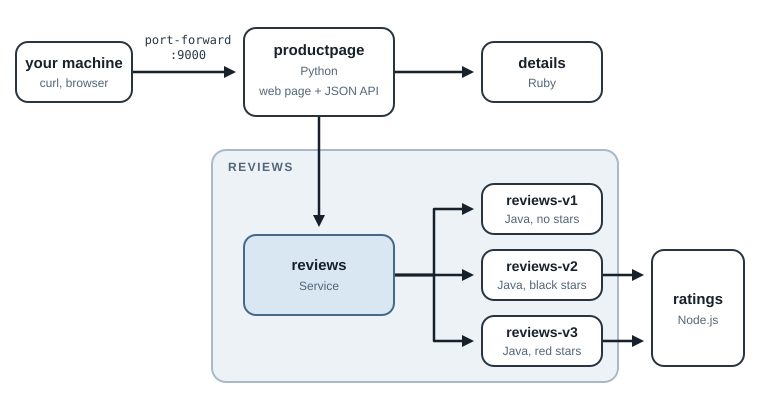
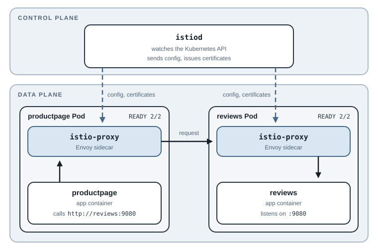

Kubernetes is good at keeping containers running. It restarts a crashed Pod, replaces a failed
node, and gives every group of Pods a stable name through a Service. What it does not manage is
the traffic between those services: which version of a service answers a request, how long a
caller waits, whether a failed call is retried, and who is allowed to call whom.

In a small app those questions are easy to ignore. Once an app is split into several services,
each one owned by a different team and deployed on its own schedule, they turn into incidents. A
new version gets more traffic than planned. A slow dependency makes one page hang. A test Pod in
another namespace reads data it should never see.

A *service mesh* handles that traffic for every service in the cluster, without changing the
services' code. This series teaches one of the most widely used, Istio, by running it on a local
cluster. This first chapter doesn't install Istio yet. It runs the example app on plain
Kubernetes and makes the problems visible, so each later chapter has a concrete problem to fix.

By the end of this chapter you will have:

- A local Kind cluster that the whole series uses.
- The Book Store app running in it.
- Four measured problems that Kubernetes alone doesn't solve, and a map of the chapter that
  solves each one.

The series assumes you can deploy an app with `kubectl` and know what a Pod, a Deployment, and a
Service are. Nothing else is required. If those terms are new, the
[Kubernetes Basics](/kubernetes-basics-series/) series covers them.

> **Code for this chapter.** All files are in
> [_resource/kubernetes-service-mesh](https://github.com/VersusControl/devops-vn-blog/tree/main/_resource/kubernetes-service-mesh).
> I tested them with Kind v0.33.0 (Kubernetes v1.37.0) on macOS with Docker Desktop, and the
> command output in this chapter comes from those runs.

Get the code and move into the series folder:

```sh
git clone https://github.com/VersusControl/devops-vn-blog.git
cd devops-vn-blog/_resource/kubernetes-service-mesh
```

Run every command in the series from this folder. The scripts and manifests use paths relative
to it, so a command run from anywhere else can't find its files.

## The Book Store App

The series uses one app from start to finish: *Book Store*, a small online book page. It is built
from the four container images of Bookinfo, Istio's official sample app. The Kubernetes manifests
are written for this series. They set up the app the way later chapters need it, and the images
have a few settings that let us make a service fail or slow down on purpose.

Book Store has four services:

| Service | Language | What it does |
| --- | --- | --- |
| `productpage` | Python | Renders the web page and a JSON API. Calls `details` and `reviews`. |
| `details` | Ruby | Returns book information: author, ISBN, page count. |
| `reviews` | Java | Returns two book reviews. Runs as three versions. |
| `ratings` | Node.js | Returns the star rating for each review. |

The `reviews` service has three versions running at the same time, all behind one Kubernetes
Service:

- `reviews-v1` shows reviews without stars and never calls `ratings`.
- `reviews-v2` calls `ratings` and shows black stars.
- `reviews-v3` calls `ratings` and shows red stars.

The map below shows who calls whom. A request from your machine reaches `productpage`, which
calls `details` and one of the three `reviews` versions; only v2 and v3 go on to call `ratings`.
Later chapters reuse this map and highlight the part they change.



Three versions of one service is the normal state of a team that ships often: the old version
still serves users while a new one is being tested. It is also where plain Kubernetes starts to
fall short, as the next sections show.

## Check Your Machine

The series runs everything on your machine with Docker and *Kind* (Kubernetes in Docker), which
runs each Kubernetes node as a Docker container. You need:

| Tool | Why | Check |
| --- | --- | --- |
| Docker | Runs the Kind nodes. Give it 8 GB of memory (6 GB minimum). | `docker info` |
| Kind v0.33.0 or later | Creates the local cluster. | `kind version` |
| `kubectl` | Talks to the cluster. | `kubectl version --client` |
| `curl` | Sends test requests. | `curl --version` |

If Kind or `kubectl` is missing, install it from the
[Kind quick start](https://kind.sigs.k8s.io/docs/user/quick-start/#installation) or the
[kubectl install page](https://kubernetes.io/docs/tasks/tools/). On Docker Desktop, the memory
setting is under "Settings" > "Resources".

The memory figure comes from a measurement. With every component of the later chapters running
(Istio, its dashboards, and extra versions of the app), the three Kind nodes used about 4.1 GB.

The repository includes a check script. Run it first:

```sh
./scripts/preflight.sh
```

```text
Tools
  ok    docker found
  ok    kind found
  ok    kubectl found
  ok    curl found
  ok    kind v0.33.0
Docker
  ok    Docker memory 7 GB
  ok    Docker CPUs 8
Ports (the Kind cluster publishes these on 127.0.0.1)
  ok    port 8080 free
  ok    port 8443 free
  ok    port 9080 free

Ready.
```

Fix any `FAIL` line before you continue. The port check matters: in later chapters the cluster
receives browser traffic on ports 8080, 8443, and 9080 of your machine, and Kind can't create the
cluster if another program already uses them. (Docker Desktop reports memory slightly under the
amount you set, so 8 GB shows as 7.)

## Create the Cluster

The cluster definition is in `cluster/kind-config.yaml`:

```yaml
kind: Cluster
apiVersion: kind.x-k8s.io/v1alpha4
name: mesh
nodes:
  - role: control-plane
    image: kindest/node:v1.37.0
    extraPortMappings:
      # Istio ingress gateway: HTTP and HTTPS (chapters 2-13)
      - containerPort: 30080
        hostPort: 8080
        listenAddress: "127.0.0.1"
      - containerPort: 30443
        hostPort: 8443
        listenAddress: "127.0.0.1"
      # Gateway API gateway (chapter 14)
      - containerPort: 30090
        hostPort: 9080
        listenAddress: "127.0.0.1"
  - role: worker
    image: kindest/node:v1.37.0
  - role: worker
    image: kindest/node:v1.37.0
```

It creates a cluster named `mesh` with one control-plane node and two workers. With two workers,
Kubernetes spreads Book Store's Pods across two nodes, so many calls between services cross the cluster network
the way they do in a real cluster. The node image is
pinned to Kubernetes v1.37.0, so every reader runs the same version. Istio 1.32, which the series
installs in chapter 2, supports Kubernetes 1.33 to 1.37.

The `extraPortMappings` block isn't used in this chapter. It connects ports on your machine to
ports on the Kind node, so that later chapters can open `http://localhost:8080` in a browser and
reach Istio inside the cluster. `listenAddress: "127.0.0.1"` keeps those ports private to your
machine. Setting them now means you create the cluster once and keep it for the whole series.

Create the cluster:

```sh
kind create cluster --config cluster/kind-config.yaml
```

It takes about 25 seconds, and longer the first time, while Docker downloads the node image. Kind also switches `kubectl` to the new cluster by setting the current *context* to
`kind-mesh`. A context is the cluster that `kubectl` sends commands to. If your machine also has a
work cluster or Docker Desktop's Kubernetes, check that the switch happened before you apply
anything:

```sh
kubectl config current-context
```

It must print `kind-mesh`. If it doesn't, run `kubectl config use-context kind-mesh`. Then check
the nodes:

```sh
kubectl get nodes
```

```text
NAME                 STATUS   ROLES           AGE    VERSION
mesh-control-plane   Ready    control-plane   115s   v1.37.0
mesh-worker          Ready    <none>          100s   v1.37.0
mesh-worker2         Ready    <none>          100s   v1.37.0
```

The nodes show `NotReady` for the first few seconds, until the network plugin starts. Wait until
all three are `Ready`.

## Deploy Book Store

The manifests are in `app/`, one file per service, combined with a `kustomization.yaml`. Each
file holds a Service, a ServiceAccount, and one Deployment per version. This is
`app/reviews.yaml`, shortened to one version:

```yaml
apiVersion: v1
kind: Service
metadata:
  name: reviews
  namespace: bookstore
spec:
  selector:
    app: reviews            # all three versions match this
  ports:
    - name: http            # Istio reads the protocol from the port name
      port: 9080
      targetPort: 9080
---
apiVersion: v1
kind: ServiceAccount
metadata:
  name: bookstore-reviews
  namespace: bookstore
---
apiVersion: apps/v1
kind: Deployment
metadata:
  name: reviews-v2
  namespace: bookstore
spec:
  selector:
    matchLabels: {app: reviews, version: v2}
  template:
    metadata:
      labels:
        app: reviews        # selected by the Service
        version: v2         # lets Istio tell the versions apart
    spec:
      serviceAccountName: bookstore-reviews
      containers:
        - name: reviews
          image: registry.istio.io/release/examples-bookinfo-reviews-v2:1.20.3
          # ... ports, readiness probe, resource requests, /tmp volume
```

Three details in these manifests are there for Istio, even though Istio isn't installed yet:

- **The `version` label.** The Service selects Pods only by `app`, so it can't tell versions
  apart. Istio uses `version` in chapter 6 to send traffic to one version on purpose.
- **The port name `http`.** Istio reads a port's protocol from its name. A port named `http`
  gets full HTTP features: routing by path, retries, per-request metrics.
- **One ServiceAccount per service.** In chapter 11 the ServiceAccount becomes each service's
  identity in the mesh, and authorization rules refer to it.

Apply the app and wait for it:

```sh
kubectl apply -k app
./scripts/wait-for-app.sh
```

```text
namespace/bookstore created
serviceaccount/bookstore-details created
...
deployment.apps/reviews-v3 created
Waiting for deployment "details-v1" rollout to finish: 0 of 1 updated replicas are available...
deployment "details-v1" successfully rolled out
...
deployment "reviews-v3" successfully rolled out
```

The first run takes a minute or two while the nodes pull the images. The three `reviews` Pods
are the slowest: the Java server needs about 20 seconds to start, so their readiness probe waits
20 seconds before its first check. `wait-for-app.sh` waits for each Deployment in turn. If one
never becomes ready, the script stops, prints that Deployment's Pods, and gives the
`kubectl describe` command that shows why.

```sh
kubectl -n bookstore get pods
```

```text
NAME                               READY   STATUS    RESTARTS   AGE
details-v1-65c85cb5f7-4688p        1/1     Running   0          99s
productpage-v1-5995f9b747-526zz    1/1     Running   0          99s
ratings-v1-c57b9b4b9-k8kft         1/1     Running   0          99s
reviews-v1-65d97f4766-n9b4r        1/1     Running   0          99s
reviews-v2-797c7f44db-76gw5        1/1     Running   0          99s
reviews-v3-665587dbf8-nzq2w        1/1     Running   0          99s
```

Each Pod shows `1/1`: one container, the app itself. Remember that number. In chapter 2 it
becomes `2/2`.

## Open the App

There is no way into the cluster from your machine yet, so forward a local port to the
`productpage` Service. Open a second terminal, move into the same folder, and run:

```sh
kubectl -n bookstore port-forward svc/productpage 9000:9080
```

This sends local port 9000 to port 9080 of a `productpage` Pod. The command doesn't return; it
holds the tunnel open until you press Ctrl+C, so leave it running for the rest of the chapter.
Local port 9000 is used because the Kind cluster already holds 9080 on your machine. If 9000 is
busy too, the command fails with `address already in use`; pick another local port and use it in
every URL below.

Back in the first terminal, request the page:

```sh
curl -s http://localhost:9000/productpage | grep -o "<title>.*</title>"
```

```text
<title>Simple Bookstore App</title>
```

You can also open `http://localhost:9000/productpage` in a browser. Refresh it a few times: the
reviews section changes between no stars, black stars, and red stars.

## Four Questions Kubernetes Can't Answer Well

The app works. Now ask the questions an operations team asks about any app in production.

### 1. Which version served this request, and can I choose?

`productpage` has a JSON API. Its reviews endpoint includes `podname`, the name of the Pod that
answered. `scripts/count-versions.sh` sends a number of requests to that endpoint and groups the
answers by HTTP status, reviews version, ratings result, and response time:

```sh
./scripts/count-versions.sh http://localhost:9000 30
```

```text
  12 200 reviews-v2 stars fast
   9 200 reviews-v3 stars fast
   9 200 reviews-v1 no-stars fast
```

Each line is a count, then the HTTP status, the `reviews` version, what happened to the stars,
and a time group: `fast` (under 1 s), `1-3s`, `3-8s`, or `slow` (over 8 s). The first line reads
"12 requests returned `200`, were answered by `reviews-v2`, showed stars, and took under a
second". Your counts will differ a little from run to run.

> **Tip:** If every line looks like `000 reviews-none - fast`, curl couldn't connect at all.
> The `port-forward` in the second terminal has stopped; start it again.

The Service spreads requests across all three versions, roughly evenly. That's correct behavior
for a Service, but it's not what a team releasing a new version wants. A normal release sends
most users to the stable version and a small share to the new one, then shifts traffic as
confidence grows. That gradual rollout is called a *canary release*.

With a Service, the only control you have is the number of Pods. To send 10% of traffic to v3,
you would need nine v1 Pods for every v3 Pod, and even then the split is approximate (question 3
shows how approximate it can get). Sending one specific user to v3, such as a QA tester, isn't
possible at all.

Notice also that the version is visible here only because this app reports its Pod name. Most
apps don't, and Kubernetes keeps no record of which Pod answered which request.

### 2. What happens when a dependency is down?

Scale `ratings` to zero Pods to simulate an outage:

```sh
kubectl -n bookstore scale deploy/ratings-v1 --replicas=0
```

Send the same 30 requests again:

```sh
./scripts/count-versions.sh http://localhost:9000 30
```

```text
   9 200 reviews-v3 ratings-error fast
   9 200 reviews-v1 no-stars fast
   7 200 reviews-v2 ratings-error fast
   5 200 reviews-v2 ratings-error 1-3s
```

Every request still returns `200`, but 21 of the 30 carry an error in place of the stars
(`ratings-error`). These are all the v2 and v3 requests, the two versions that call `ratings`.
The JSON shows the message that the page displays: `"Ratings service is currently unavailable"`.
Five of the failing v2 requests also took between one and three seconds, and nothing in the
cluster tells you why.

The page still loads because each version of `reviews` handles a failed call to `ratings` in
its own Java code. That handling is all there is. Nothing outside that code retries the call,
and nothing lets you change how long a caller waits. And because the status code is `200`,
anything that watches status codes sees a healthy app. You only noticed the failures because the
script reads the response body.

Bring `ratings` back before you continue:

```sh
kubectl -n bookstore scale deploy/ratings-v1 --replicas=1
```

### 3. What happens when a dependency is slow?

A slow dependency is worse than one that's down, because callers wait. The Book Store team ships
a new `ratings` build that, as it turns out, takes 7 seconds to answer half of its requests.
The `ratings` image has a setting for exactly this: `SERVICE_VERSION=v-delayed`. The manifest
`01-why-service-mesh/ratings-v-delayed.yaml` deploys it next to v1, with the same `app: ratings`
label and a different `version`:

```sh
kubectl apply -f 01-why-service-mesh/ratings-v-delayed.yaml
kubectl -n bookstore get pods -l app=ratings
```

```text
NAME                                 READY   STATUS    RESTARTS   AGE
ratings-v-delayed-69d8949d8d-7gzjt   1/1     Running   0          18s
ratings-v1-c57b9b4b9-4h4n8           1/1     Running   0          18s
```

Two Pods behind the `ratings` Service, one of them slow half the time. A fair guess is that about
a quarter of rating calls become slow. Send 90 requests and check:

```sh
./scripts/count-versions.sh http://localhost:9000 90
```

```text
  31 200 reviews-v2 stars fast
  30 200 reviews-v1 no-stars fast
  29 200 reviews-v3 stars fast
```

Everything is fast. (Your run may show some `ratings-error` or slower lines instead. That is the
same effect with a different outcome; the explanation below covers both.) Count the requests each
`ratings` Pod received, using its log:

```sh
kubectl -n bookstore logs deploy/ratings-v-delayed | grep -c 'GET /ratings'
kubectl -n bookstore logs deploy/ratings-v1 | grep -c 'GET /ratings'
```

```text
0
60
```

The 60 calls are the 31 v2 requests plus the 29 v3 requests; v1 never calls `ratings`. All of
them went to `ratings-v1`, and the new Pod received nothing.

The new Pod isn't broken. To prove it, start a temporary Pod that calls `ratings` eight times
with `curl` and prints how long each call took. `--rm` deletes the Pod when the loop ends. The
loop can take up to a minute, because slow calls wait 7 seconds each:

```sh
kubectl -n bookstore run tmp-curl --image=docker.io/curlimages/curl:8.16.0 \
  --restart=Never --rm -i --command -- sh -c \
  'for i in 1 2 3 4 5 6 7 8; do curl -s -o /dev/null -w "%{time_total}\n" http://ratings:9080/ratings/0; done'
```

```text
7.005642
7.005737
0.002854
7.006972
0.002898
0.003152
0.001312
7.004234
pod "tmp-curl" deleted
```

Four of the eight calls took 7 seconds. Your count will differ, because each new connection is a
new random pick.

The slow Pod answers when it gets a call. So why did `reviews` never call it? The answer is in
how a Service balances traffic.

A Service doesn't look at HTTP requests. It works on connections. When a caller opens a TCP
connection to the Service, the node picks one ready Pod for that connection, using packet rules
that kube-proxy (the Kubernetes component that implements Services) keeps up to date. Every
request sent over that connection goes to the same Pod. A new connection gets a new pick.

The test Pod opened a new connection for every `curl`, so each call got a fresh pick, and some
landed on the slow Pod. The `reviews` server does the opposite. It opens one connection to
`ratings` and reuses it for every call. I checked this by counting the open connections inside
each `reviews` Pod: one each. Two `reviews` Pods call `ratings` (v2 and v3), so the Service made
only two picks for all 60 calls. In this run both picks were `ratings-v1`.


The figure puts the two callers side by side. The Service made the same kind of choice for both;
the only difference is how many connections each caller opened.

The same rule explains question 1. `productpage` opens a new connection for every call to
`reviews`. Its source code skips connection reuse on purpose, with a comment saying this makes
load spread across the versions. So each of its calls gets a fresh pick.

I ran the steps of this section three times. Twice the slow Pod received no traffic from
`reviews`. Once it received a share, and one request came back with a ratings error. Your result
may differ, and that's the point: which users meet the slow build depends on when connections
were opened, not on any decision you made. The picks change only when a connection closes. The
`reviews` connections close after a pause in traffic (I counted none open while no requests were running,
and one per Pod again as soon as requests resumed), and the next call makes a new pick.

(The proxies that Istio adds in chapter 2 pick a Pod for every HTTP request, not for every
connection. Chapter 6 uses that to send a share of traffic that you choose to each version.)

When the slow Pod does get traffic, the two `reviews` versions react differently.
`reviews-v3` gives up on `ratings` after 2.5 seconds and shows an error; that was the failed
request in my third run. `reviews-v2` waits up to 10 seconds. Both limits are hard-coded in the
Java source. `productpage` has its own, in Python: 3 seconds per call to `reviews`, with one
retry. That makes three timeouts in two codebases, and Kubernetes can't show or change any of
them. (Chapter 8 shows what happens when they meet.)

In short, the slow build reached production, it reached a share of users that nobody chose and
nobody could predict, and the only fix Kubernetes offers is to remove it. Leave it running for
now; the cleanup at the end of the chapter deletes it.

### 4. Who can call whom, and can anyone read the traffic?

Create a namespace that has nothing to do with Book Store, start a test Pod in it, and call
`ratings` directly. The test Pod only sleeps, so you can run commands inside it with
`kubectl exec`. The `wait` line holds until the Pod is running, because an `exec` sent earlier
fails. The address `ratings.bookstore` means the `ratings` Service in the `bookstore` namespace.

```sh
kubectl create namespace experiments
kubectl -n experiments run curl --image=docker.io/curlimages/curl:8.16.0 \
  --restart=Never --command -- sleep 3600
kubectl -n experiments wait --for=condition=Ready pod/curl --timeout=60s
kubectl -n experiments exec curl -- curl -s -i http://ratings.bookstore:9080/ratings/0
```

The last command prints the response headers and body:

```text
HTTP/1.1 200 OK
Content-type: application/json
...

{"id":0,"ratings":{"Reviewer1":5,"Reviewer2":4}}
```

Any Pod in the cluster can call any Service, and the call is plain HTTP. Nothing checks who the
caller is, and anyone who can capture traffic on the node network can read it.

Kubernetes has a partial answer, the NetworkPolicy. It can say "only Pods labeled
`app: reviews` may connect to `ratings` on port 9080". It works on connections, though, not
requests, so it can't add "and only with `GET`". It trusts any Pod that carries the right label,
and it doesn't encrypt anything.

## Where This Logic Usually Lives

Every one of those problems has a solution, and many teams solve them in application code.
Retries and timeouts come from an HTTP client library. Canary releases come from a feature-flag
service. Encryption comes from TLS certificates that each service loads and renews. Metrics come
from an instrumentation library.

Book Store shows why that approach struggles. Its four services are written in four languages,
so every rule has to be written four times, with four libraries that each behave a little
differently. The timeouts in question 3 are already inconsistent. A change to the retry policy
means four code changes and four releases. And a service that forgets to load its certificate
sends plain text.

A service mesh moves that logic out of the services. Next to every service it runs a small
network proxy that the service's traffic passes through. The proxy applies retries, timeouts,
routing, encryption, and metrics. Because every proxy is the same program, the rules work the
same way in Python, Ruby, Java, and Node.js, and you change them with configuration instead of
code.


The figure shows the whole idea of the series. On the left, the same four concerns are copied
into every service. On the right, the services keep only their business code, and the proxies
carry the rest.

## How Istio Is Built

Istio splits the work into two parts: a data plane that handles requests and a control plane
that configures it.



The *data plane* is the set of proxies that handle the actual requests. Istio uses
[Envoy](https://www.envoyproxy.io/), an open-source network proxy. In the mode this series uses,
Istio runs one Envoy inside every Pod as an extra container, called a *sidecar*. When
`productpage` calls `reviews`, the request leaves through the Envoy in the `productpage` Pod and
enters through the Envoy in the `reviews` Pod. The app code still calls `http://reviews:9080`
and doesn't know the proxies exist.

The *control plane* is one component, `istiod`. It doesn't touch requests. It watches the
Kubernetes API for Services, Pods, and Istio's own configuration objects, turns them into Envoy
configuration, and pushes that configuration to every proxy. It also acts as a certificate
authority and gives each proxy a certificate for encrypted traffic.

So when you tell Istio "send 10% of reviews traffic to v3", you write one configuration object.
`istiod` sends it to the proxies, and the proxy in the `productpage` Pod makes the choice for
every request. Nothing restarts and no code changes. This is also why the connection problem from
question 3 goes away: the proxy decides per request, whatever connections the app keeps open.

> **Note:** Istio also has a newer *ambient mode* that runs without sidecars. It uses a
> per-node proxy for encryption and an optional extra proxy, usually one per namespace, for HTTP
> features. This series uses sidecar mode, because it supports every feature the series covers,
> and because each concept is easier to see when the proxy sits in the same Pod as the app.

## What Each Chapter Fixes

Chapter 2 installs Istio and adds Book Store to the mesh. After that, each problem from this
chapter, plus a few that come up later, has its own chapter:

| Problem | Istio feature | Chapter |
| --- | --- | --- |
| No way into the cluster without port-forward | Ingress gateway, Gateway, VirtualService | 3–5 |
| Traffic splits by Pod count; can't choose a version | Subsets and weighted routing | 6 |
| Can't send one user to the new version | Routing by header | 7 |
| Slow dependency, inconsistent timeouts | Timeouts, retries, fault injection | 8 |
| A bad Pod keeps receiving traffic | Circuit breaking and outlier detection | 9 |
| Calls to outside services aren't controlled | ServiceEntry and egress gateway | 10 |
| Plain-text traffic between services | Mutual TLS | 11 |
| Any Pod can call any service | Authorization policies | 12 |
| No record of who called whom | Metrics, tracing, Kiali | 13 |

Chapter 14 shows the same traffic rules with the Kubernetes Gateway API, and chapter 15 installs
Istio the way you would in your own environment.

## When a Service Mesh Is Not Worth It

A mesh isn't free. Every Pod gets an extra container that uses memory and CPU, every request
passes through two extra proxies, and the team has a new system to learn, upgrade, and debug.

It is usually not worth it when:

- You run one or two services, or a monolith. A good HTTP client library is simpler.
- Your services rarely call each other, and most traffic is user → app → database.
- Nobody on the team has time to own the mesh. An unmaintained mesh is a risk of its own.

It starts to pay off when several teams ship services in different languages, when you need
canary releases or encryption between services, or when a security review asks who can call
what.

## Before the Next Chapter

Remove the experiments from this chapter and keep the cluster:

```sh
kubectl delete -f 01-why-service-mesh/ratings-v-delayed.yaml
kubectl delete namespace experiments
```

Stop the `port-forward` in the second terminal with Ctrl+C. Book Store stays deployed, and
chapter 2 installs Istio into this cluster.

If you stop here and come back later, check that the cluster still exists with
`kind get clusters`; it should list `mesh`. If it doesn't, or if something is in a state you
don't understand, start over with one command:

```sh
./scripts/bootstrap.sh 01
```

`bootstrap.sh` deletes the `mesh` cluster if it exists and creates a fresh one in the state the
given chapter starts from. Chapter 1 starts from an empty cluster, so run the steps from "Deploy
Book Store" again afterwards. Later chapters work the same way with their own number, so you can
start any chapter without redoing the ones before it.

When you finish the series, or need the memory back, delete the cluster. Skip this if you go on
to chapter 2, which uses the cluster as it is now:

```sh
kind delete cluster --name mesh
```

## Summary

- Kubernetes keeps services running and gives them stable names. It doesn't decide which version
  answers, how long callers wait, or who may call whom.
- On plain Kubernetes, Book Store split traffic by Pod count, hid ratings failures behind `200`
  responses with no retry, sent a slow new build an unpredictable share of traffic (often none)
  because Services balance connections rather than requests, and accepted plain-text calls from
  any namespace.
- Solving this in each service means writing the same logic in every language and keeping it
  consistent by hand.
- A service mesh puts a proxy next to every service (the data plane) and configures all of them
  from one place (the control plane). In Istio these are Envoy and `istiod`.
- You now have a `mesh` Kind cluster with Book Store running. In the next chapter you install
  Istio 1.32 and add the app to the mesh.
