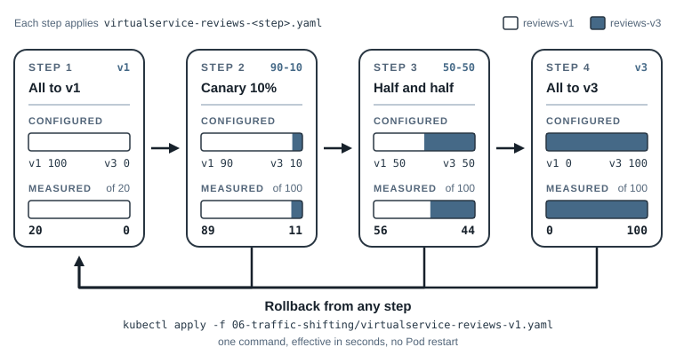

Book Store runs three versions of `reviews` side by side, and the `reviews` Service spreads
requests across all of them. Chapter 1 measured it: about a third each, with no way to change
the split except by changing the number of Pods. That's not how a team wants to release. The
`reviews` team has finished v3, which shows red stars, and wants it to reach users gradually:
first a small share, then half, then everyone, with a one-command rollback at every step.

That gradual move is the *canary release* from chapter 1. In Istio it takes two objects. A
`DestinationRule` gives each version a name. A `VirtualService` says how much traffic each name
gets. This chapter introduces both and runs the canary from 0% to 100%. It also shows where the
routing decision happens: in the sidecar of the service that makes the call, not at the `reviews`
Service. That detail decides which clients your canary actually covers.

By the end of this chapter you will:

- Define *subsets* of a service by Pod label with a `DestinationRule`.
- Route traffic inside the mesh with a `VirtualService` that has no gateway.
- Shift traffic between versions by weight and measure each step.
- Explain why a client without a sidecar ignores all of this.
- Apply `DestinationRule` and `VirtualService` in the right order, and recognize the `503` you
  get when the order is wrong.

> **Code for this chapter.** The files are in
> [_resource/kubernetes-service-mesh/06-traffic-shifting](https://github.com/VersusControl/devops-vn-blog/tree/main/_resource/kubernetes-service-mesh/06-traffic-shifting).
> I tested them with Kind v0.33.0 (Kubernetes v1.37.0) and Istio 1.32.0 on macOS with Docker
> Desktop, and the command output in this chapter comes from those runs.

## Starting Point

Run every command from `_resource/kubernetes-service-mesh` with the series' `istioctl` on your
PATH (`export PATH="$PWD/bin:$PATH"`). The chapter needs Book Store in the mesh and reachable at
`http://bookstore.local:8080`, the state chapter 5 ended in. To build it from scratch:

```sh
./scripts/bootstrap.sh 06
```

Measure the current split with the script from chapter 1. It calls the reviews API through the
gateway and counts which version answered:

```sh
./scripts/count-versions.sh http://bookstore.local:8080 30
```

```text
  14 200 reviews-v2 stars fast
   9 200 reviews-v1 no-stars fast
   7 200 reviews-v3 stars fast
```

Roughly a third each. The plan is to send everything to v1 first, then move traffic to v3 in
steps.

## Two Objects: Where to Send, and What the Names Mean

Routing between versions needs two pieces of information, and Istio keeps them in two objects:


- A **`VirtualService`** decides *where* a request goes: which subset, with which weight, for
  which request. You met it at the gateway in chapter 3.
- A **`DestinationRule`** defines *what a destination is* and how to treat it once chosen: its
  subsets in this chapter, and later traffic policies such as connection limits (chapter 9) and
  TLS settings (chapter 11).

A *subset* is a named group of a Service's Pods, selected by label. `reviews` already has the
label it needs: every Deployment from chapter 1 sets `version: v1`, `v2`, or `v3` on its Pods,
while the Service selects only by `app: reviews`.

`06-traffic-shifting/destinationrule-reviews.yaml`:

```yaml
apiVersion: networking.istio.io/v1
kind: DestinationRule
metadata:
  name: reviews
  namespace: bookstore
spec:
  host: reviews
  subsets:
    - name: v1
      labels:
        version: v1
    - name: v2
      labels:
        version: v2
    - name: v3
      labels:
        version: v3
```

`host: reviews` is the Kubernetes Service, completed with the object's namespace
(`reviews.bookstore.svc.cluster.local`). Each subset is a name plus a label selector applied to
that Service's Pods. The names are yours to choose; using the version label's values keeps them
obvious.

## Break It First: The Wrong Apply Order

The canary's first step pins all traffic to v1. That's a `VirtualService` that sends `reviews`
traffic to subset `v1`, `06-traffic-shifting/virtualservice-reviews-v1.yaml`:

```yaml
apiVersion: networking.istio.io/v1
kind: VirtualService
metadata:
  name: reviews
  namespace: bookstore
spec:
  hosts:
    - reviews
  http:
    - route:
        - destination:
            host: reviews
            subset: v1
```

This `VirtualService` has no `gateways` field. Without it, the routes apply inside the mesh:
to every sidecar that sends a request to `reviews` (Istio calls this the implicit `mesh`
gateway). `productpage` calls `http://reviews:9080`, so its sidecar uses these routes.

A common mistake is to apply the `VirtualService` before the `DestinationRule` it depends on.
Make that mistake on purpose:

```sh
kubectl apply -f 06-traffic-shifting/virtualservice-reviews-v1.yaml
./scripts/count-versions.sh http://bookstore.local:8080 10
```

```text
virtualservice.networking.istio.io/reviews created
  10 503 reviews-none - fast
```

Every request fails. `productpage` returns `503` with
`{"error": "Sorry, product reviews are currently unavailable for this book."}`, because its call
to `reviews` failed. The call to `reviews` leaves through `productpage`'s sidecar, so that
sidecar's access log has the response flag (chapter 5's table):

```sh
kubectl -n bookstore logs deploy/productpage-v1 -c istio-proxy --tail=20 | grep 'reviews:9080' | tail -1
```

```text
[2026-11-17T01:31:22.161Z] "GET /reviews/0 HTTP/1.1" 503 NC cluster_not_found - "-" 0 0 0 - "-" "curl/8.7.1" "67a74735-9be2-4dad-83d4-9500afff57c0" "reviews:9080" "-" - - 10.96.121.127:9080 10.244.2.16:33972 - -
```

The flag is `NC cluster_not_found`, and the upstream host and cluster are both `-`: nothing was
called. In chapter 5, `NC` came from a wrong `destination.host`. Here the host is right, but the
route points at a cluster for subset `v1`, and that cluster doesn't exist because nothing has
defined `v1` yet. `istioctl analyze` names the missing piece:

```sh
istioctl analyze -n bookstore
```

```text
Error [IST0101] (VirtualService bookstore/reviews) Referenced host+subset in destinationrule not found: "reviews+v1"
Error: Analyzers found issues when analyzing namespace: bookstore.
See https://istio.io/v1.32/docs/reference/config/analysis for more information about causes and resolutions.
```

Apply the `DestinationRule`:

```sh
kubectl apply -f 06-traffic-shifting/destinationrule-reviews.yaml
./scripts/count-versions.sh http://bookstore.local:8080 20
```

```text
destinationrule.networking.istio.io/reviews created
  20 200 reviews-v1 no-stars fast
```

All 20 requests went to v1, with no restart and no change to any Deployment. Look at the
clusters `productpage`'s sidecar has for `reviews` now:

```sh
istioctl proxy-config cluster deploy/productpage-v1 -n bookstore --fqdn reviews.bookstore.svc.cluster.local
```

```text
SERVICE FQDN                            PORT     SUBSET     DIRECTION     TYPE     DESTINATION RULE
reviews.bookstore.svc.cluster.local     9080     -          outbound      EDS      reviews.bookstore
reviews.bookstore.svc.cluster.local     9080     v1         outbound      EDS      reviews.bookstore
reviews.bookstore.svc.cluster.local     9080     v2         outbound      EDS      reviews.bookstore
reviews.bookstore.svc.cluster.local     9080     v3         outbound      EDS      reviews.bookstore
```

One cluster per subset, plus the original one for the whole Service. The subset clusters are
named `outbound|9080|v1|reviews...`: the third field, empty in chapter 5, now holds the subset.

The rule for your own releases: **add the `DestinationRule` first, then the `VirtualService`
that uses it. When removing, delete the `VirtualService` first.** Putting both in one
`kubectl apply` usually works, but nothing guarantees that every sidecar receives the subsets
before the route that needs them, so a busy service can see a few `503`s in between. The safe
sequence is two steps: apply the `DestinationRule`, wait a few seconds until
`istioctl proxy-config cluster` shows the subset clusters, then apply the `VirtualService`.

## Run the Canary

With v1 pinned, release v3 in steps. Each step is one file with the same `VirtualService`
name, so applying it replaces the previous routes. Only the weights change.
`06-traffic-shifting/virtualservice-reviews-90-10.yaml`:

```yaml
# ... apiVersion, kind, and metadata as in virtualservice-reviews-v1.yaml
spec:
  hosts:
    - reviews
  http:
    - route:
        - destination:
            host: reviews
            subset: v1
          weight: 90
        - destination:
            host: reviews
            subset: v3
          weight: 10
```

Each `weight` is a share of the rule's traffic. Istio treats the weights as relative (each
destination gets its weight divided by the total), but keeping the total at 100 lets you read
them as percentages. (I checked: weights of 9 and 1 passed `istioctl analyze` and split 100
requests 92/8.) The sidecar picks a destination at random for every request with these odds,
so small samples drift; 100 requests give a fair picture.

```sh
kubectl apply -f 06-traffic-shifting/virtualservice-reviews-90-10.yaml
./scripts/count-versions.sh http://bookstore.local:8080 100
```

```text
virtualservice.networking.istio.io/reviews configured
  89 200 reviews-v1 no-stars fast
  11 200 reviews-v3 stars fast
```

89 and 11, close to 90/10. This is the step where a real team watches v3's error rate and
latency (chapter 13 shows how) before going further. Next, half and half:

```sh
kubectl apply -f 06-traffic-shifting/virtualservice-reviews-50-50.yaml
./scripts/count-versions.sh http://bookstore.local:8080 100
```

```text
virtualservice.networking.istio.io/reviews configured
  56 200 reviews-v1 no-stars fast
  44 200 reviews-v3 stars fast
```

And finally all traffic to v3:

```sh
kubectl apply -f 06-traffic-shifting/virtualservice-reviews-v3.yaml
./scripts/count-versions.sh http://bookstore.local:8080 100
```

```text
virtualservice.networking.istio.io/reviews configured
 100 200 reviews-v3 stars fast
```



v1 still runs, receiving nothing. Rolling back at any step is one command,
`kubectl apply -f 06-traffic-shifting/virtualservice-reviews-v1.yaml`, and takes effect in
seconds because no Pod starts or stops. When v3 has run on full traffic long enough to trust it,
the team deletes the v1 Deployment.

Notice what didn't happen. Unlike chapter 1, where the split depended on Pod counts and on which
connections happened to be open, every split here came from a number in YAML, and v3 ran on one
Pod the whole time. Traffic share and capacity are now separate decisions. That cuts both ways:
the mesh won't add v3 Pods when you raise its weight, so scale v3 for full traffic before the
last step.

The random pick per request has one more consequence. The same user can get v1 on one page load
and v3 on the next. For a change in star color that's harmless. For a new checkout flow or a
changed API response, it may not be, and a percentage can't fix that. Chapter 7 sends chosen
users to one version instead.

## Where the Decision Is Made

Ask where "send 10% to v3" happens. The intuitive answer is "at the `reviews` Service", and it's
wrong. A Kubernetes Service is only an IP and a set of packet rules; it knows nothing about
subsets. The decision is made in the caller's sidecar. Put the 90/10 split back:

```sh
kubectl apply -f 06-traffic-shifting/virtualservice-reviews-90-10.yaml
```

Then look at the route in `productpage`'s sidecar. The full JSON is long, so the Python snippet
prints only the weights of the `reviews` route. (Without `python3`, stop the command at `-o json`
and search the output for `weightedClusters`.)

```sh
istioctl proxy-config route deploy/productpage-v1 -n bookstore --name 9080 -o json | python3 -c '
import json, sys
for rc in json.load(sys.stdin):
    for vh in rc["virtualHosts"]:
        if vh["name"].startswith("reviews."):
            print(json.dumps(vh["routes"][0]["route"]["weightedClusters"], indent=2))'
```

```text
{
  "clusters": [
    {
      "name": "outbound|9080|v1|reviews.bookstore.svc.cluster.local",
      "weight": 90
    },
    {
      "name": "outbound|9080|v3|reviews.bookstore.svc.cluster.local",
      "weight": 10
    }
  ]
}
```

`--name 9080` selects the route table for outbound calls to port 9080. Its `reviews` virtual host
holds the weights. When the `productpage` app calls `reviews:9080`, its sidecar rolls the 90/10
dice and sends the request straight to a Pod in the chosen subset. The `reviews` Pods receive the
request already decided.


It follows that a client without a sidecar never sees the `VirtualService`. To check, leave the
90/10 route in place, start a test Pod in a namespace without sidecar injection, and call
`reviews` 30 times directly. The `grep` pair pulls the version out of each JSON answer:

```sh
kubectl create namespace outside
kubectl -n outside run curl --image=docker.io/curlimages/curl:8.16.0 \
  --restart=Never --command -- sleep 3600
kubectl -n outside wait --for=condition=Ready pod/curl --timeout=90s
kubectl -n outside exec curl -- sh -c 'for i in $(seq 30); do
  curl -s http://reviews.bookstore:9080/reviews/0 | grep -o "\"podname\": *\"reviews-v[0-9]" | grep -o "v[0-9]$"
done | sort | uniq -c'
```

```text
namespace/outside created
pod/curl created
pod/curl condition met
      6 v1
     13 v2
     11 v3
```

All three versions, including v2, which no route mentions. The request went through the plain
Kubernetes Service, exactly as in chapter 1. This matters in practice. A Pod in a namespace
without injection, a Job that runs with injection turned off, or a client that reaches `reviews`
through a NodePort instead of through `productpage` all bypass your canary. A mesh-internal
`VirtualService` like this one only governs calls that leave a sidecar. (A gateway applies only
the `VirtualService` objects that name it in `gateways`, as in chapter 3.) Chapter 11 shows how
to block clients without a sidecar altogether.

> **Tip:** Kiali shows the same split. Send traffic through the gateway first
> (`./scripts/count-versions.sh http://bookstore.local:8080 100`), because the graph only draws
> recent requests. Then open it with `istioctl dashboard kiali`, choose the
> "Versioned app graph" for `bookstore`, and enable the "Traffic Distribution" edge label: the
> edges from `productpage` to `reviews` v1 and v3 show their percentages.

## Reset Before the Next Chapter

Delete the `VirtualService` and the test namespace. Keep the `DestinationRule`: chapter 7 routes
to the same subsets. (If you remove the `DestinationRule` in your own cluster, delete the
`VirtualService` first, as the rule above says.)

```sh
kubectl delete -f 06-traffic-shifting/virtualservice-reviews-90-10.yaml
kubectl delete namespace outside
./scripts/count-versions.sh http://bookstore.local:8080 30
```

```text
virtualservice.networking.istio.io "reviews" deleted
namespace "outside" deleted
  11 200 reviews-v3 stars fast
  10 200 reviews-v2 stars fast
   9 200 reviews-v1 no-stars fast
```

Without a `VirtualService`, the sidecars balance across all of the Service's Pods again. To
rebuild the starting state of chapter 7 from scratch: `./scripts/bootstrap.sh 07`.

## Summary

- A `DestinationRule` defines subsets: named groups of a Service's Pods selected by label. A
  `VirtualService` sends traffic to those names with weights.
- A `VirtualService` without `gateways` applies inside the mesh, to every sidecar that calls the
  host.
- Apply the `DestinationRule` before the `VirtualService`. A route to an undefined subset fails
  with `503 NC cluster_not_found`, and `istioctl analyze` reports `IST0101`.
- A canary is a series of weight changes: 90/10, 50/50, and 0/100, measured as 89/11, 56/44,
  and 0/100. Rollback is one `kubectl apply` and needs no Pod restart.
- The decision is made in the caller's sidecar. A client without a sidecar ignores the
  `VirtualService`. Next, chapter 7 routes by who the user is instead of by percentage.
