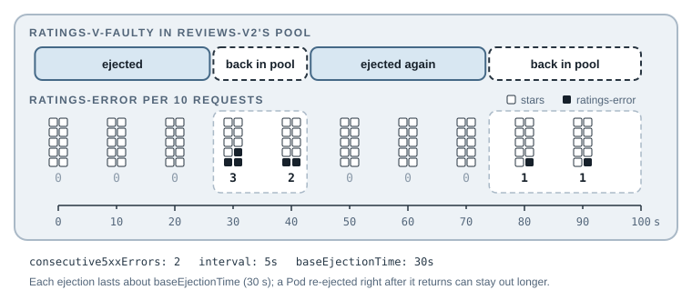
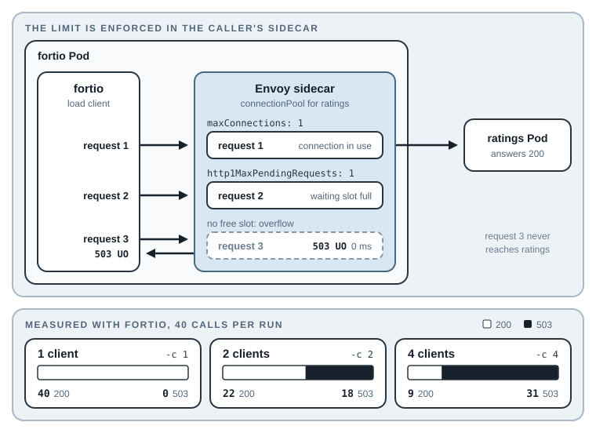

A Kubernetes Service sends traffic to every Pod whose readiness probe passes. The probe usually
calls a `/health` endpoint, and `/health` usually answers "healthy" as long as the process is up.
So a Pod that fails half of its real requests (a bad cache, say, or a broken connection to its
database) keeps receiving its full share of traffic, because its health check still passes.

Chapter 8 handled slow and failing calls one request at a time, with timeouts and retries. This
chapter works at the level of the destination. Istio's `DestinationRule` can watch how each Pod
answers and remove the ones that keep failing (*outlier detection*), and it can cap how many
connections and waiting requests a service receives (*circuit breaking*), so an overloaded
service sheds load quickly instead of collapsing.

By the end of this chapter you will:

- Remove a failing Pod from the load balancer automatically with `outlierDetection`, and watch
  it get ejected, return, and get ejected again.
- See which Pods a sidecar has ejected with `istioctl proxy-config endpoint`.
- Cap traffic to a service with `connectionPool` and recognize the `503 UO` it returns when the
  cap is reached.
- Explain why outlier detection can't save a service whose Pods are all bad.

> **Code for this chapter.** The files are in
> [_resource/kubernetes-service-mesh/09-circuit-breaking](https://github.com/VersusControl/devops-vn-blog/tree/main/_resource/kubernetes-service-mesh/09-circuit-breaking).
> I tested them with Kind v0.33.0 (Kubernetes v1.37.0) and Istio 1.32.0 on macOS with Docker
> Desktop, and the command output in this chapter comes from those runs.

## Starting Point

Run every command from `_resource/kubernetes-service-mesh`:

```sh
export PATH="$PWD/bin:$PATH"
```

The chapter needs Book Store at `http://bookstore.local:8080` and the `reviews`
`DestinationRule` from chapter 6, with no other routing objects. That's where chapter 8's reset
left the cluster. To build it from scratch:

```sh
./scripts/bootstrap.sh 09
```

## A Bad Pod That Kubernetes Keeps

The `ratings` team ships a build with a bug: half of its answers are `503`. The image has a
setting that does exactly that, `SERVICE_VERSION=v-faulty`. Its `/health` endpoint still answers
"healthy", which is what makes this kind of bug hard to catch.
`09-circuit-breaking/ratings-v-faulty.yaml` deploys it next to `ratings-v1`, behind the same
Service. Two more files help:

- `fortio.yaml`: Fortio, the load-testing tool from the Istio project, as a client inside the mesh.
  The circuit-breaking section uses it.
- `virtualservice-reviews-v2.yaml`: all `reviews` traffic to v2, which calls `ratings` on every
  request, so every request tests `ratings`.

```sh
kubectl apply -f 09-circuit-breaking/ratings-v-faulty.yaml \
  -f 09-circuit-breaking/fortio.yaml \
  -f 09-circuit-breaking/virtualservice-reviews-v2.yaml
kubectl -n bookstore rollout status deploy/ratings-v-faulty
kubectl -n bookstore rollout status deploy/fortio
kubectl -n bookstore get pods -l app=ratings
```

```text
deployment.apps/ratings-v-faulty created
deployment.apps/fortio created
virtualservice.networking.istio.io/reviews created
...
deployment "ratings-v-faulty" successfully rolled out
...
deployment "fortio" successfully rolled out
NAME                                READY   STATUS    RESTARTS   AGE
ratings-v-faulty-66bb9776f7-6mdvm   2/2     Running   0          20s
ratings-v1-864f4f9bd8-vwbt9         2/2     Running   0          42m
```

Both Pods are `Running` and ready. As far as Kubernetes knows, `ratings` is healthy. Measure what
users get:

```sh
./scripts/count-versions.sh http://bookstore.local:8080 40
```

```text
  28 200 reviews-v2 stars fast
  12 200 reviews-v2 ratings-error fast
```

12 of 40 pages lost their stars. The sidecar in `reviews-v2` sends about half of the `ratings`
calls to the faulty Pod, and half of those fail, so you'd expect about a quarter of all requests
to fail; this run got a little more. No retry hides the failures: the default retry policy from
chapter 5 retries connection failures, not a `503` that the app itself returns. And Kubernetes
will keep sending traffic to this Pod for as long as it runs.

## Eject the Bad Pod: Outlier Detection

*Outlier detection* is a passive health check. Every sidecar that calls `ratings` watches the
answers it gets from each `ratings` Pod. A Pod that crosses a threshold of failures is *ejected*:
removed from that sidecar's load-balancing pool for a while. Nothing calls `/health`; real
traffic is the test. Each sidecar keeps its own view, so every caller has to see the failures
for itself before it stops sending to the bad Pod.

The policy for `ratings` is in `09-circuit-breaking/destinationrule-ratings-outlier.yaml`:

```yaml
apiVersion: networking.istio.io/v1
kind: DestinationRule
metadata:
  name: ratings
  namespace: bookstore
spec:
  host: ratings
  trafficPolicy:
    outlierDetection:
      consecutive5xxErrors: 2
      interval: 5s
      baseEjectionTime: 30s
      maxEjectionPercent: 50
```

- `consecutive5xxErrors: 2`: two server errors in a row from one Pod trigger an ejection. The
  ejection happens at once, on the second error.
- `interval: 5s`: how often the sidecar sweeps its Pods. On each sweep it lets back in the
  ejected Pods whose time is up.
- `baseEjectionTime: 30s`: the length of the first ejection. Envoy multiplies it by the number of
  times the Pod has been ejected in a row, so a Pod that fails again soon after it returns stays
  out for 60 seconds, then 90. Every sweep that finds the Pod back in the pool takes one off that
  count, so a Pod that behaves for a while starts again from 30 seconds.
- `maxEjectionPercent: 50`: never eject more than half of the Pods, so a bad day for everyone
  doesn't empty the pool.

Settings under `trafficPolicy` apply to all traffic to the host, whatever subset or route sent
it. This `DestinationRule` has no subsets, because nothing routes to `ratings` by version in this
chapter.

```sh
kubectl apply -f 09-circuit-breaking/destinationrule-ratings-outlier.yaml
./scripts/count-versions.sh http://bookstore.local:8080 40
istioctl proxy-config endpoint deploy/reviews-v2 -n bookstore \
  --cluster "outbound|9080||ratings.bookstore.svc.cluster.local"
kubectl -n bookstore get pod -l app=ratings -o wide | awk '{print $1, $6}'
```

```text
destinationrule.networking.istio.io/ratings created
  38 200 reviews-v2 stars fast
   2 200 reviews-v2 ratings-error fast
ENDPOINT             STATUS      OUTLIER CHECK     CLUSTER
10.244.2.10:9080     HEALTHY     OK                outbound|9080||ratings.bookstore.svc.cluster.local
10.244.2.22:9080     HEALTHY     FAILED            outbound|9080||ratings.bookstore.svc.cluster.local
NAME IP
ratings-v-faulty-66bb9776f7-6mdvm 10.244.2.22
ratings-v1-864f4f9bd8-vwbt9 10.244.2.10
```

Only 2 of 40 pages lost their stars this time, down from 12. Those two were the price of
detection: the faulty Pod had to fail twice in a row before the sidecar acted. The endpoint table
shows the result. `10.244.2.22`, the faulty Pod, has `OUTLIER CHECK FAILED`, and the sidecar
sends it nothing. Its `STATUS` is still `HEALTHY`, because that column reflects Kubernetes' view
(the Pod is ready). The outlier check is the sidecar's own judgment, and for load balancing it
overrides `STATUS`.


### Watch ejection over time

An ejection isn't permanent. The Pod comes back after its ejection time, gets real traffic again,
and is ejected again if it still fails. Watch that happen: the loop below sends 10 requests about
every 10 seconds for 100 seconds and prints one line per batch.

```sh
for i in $(seq 10); do
  printf '%3ss ' $(( (i-1)*10 ))
  ./scripts/count-versions.sh http://bookstore.local:8080 10 | awk '{printf "%s %s  ", $1, $4} END {print ""}'
  sleep 9
done
```

```text
  0s 10 stars
 10s 10 stars
 20s 10 stars
 30s 7 stars  3 ratings-error
 40s 8 stars  2 ratings-error
 50s 10 stars
 60s 10 stars
 70s 10 stars
 80s 9 stars  1 ratings-error
 90s 9 stars  1 ratings-error
```

Each line is the time since the loop started and the result of that batch of 10. Read it in
windows:

- 0 to 20 s: no errors. The faulty Pod is still out from the ejection during the previous
  command.
- 30 to 40 s: the Pod is back and fails 5 requests across two batches, until two failures land
  in a row and it's ejected again.
- 50 to 70 s: out again, no errors.
- 80 to 90 s: back again, one error per batch.

Errors appear only while the Pod is back in the pool. The window edges are rough: the loop
started a few seconds after the first ejection, and a Pod returns only on one of the 5-second
sweeps.

Notice that the second ejection lasted about 30 seconds, not 60. I read that as the countdown from
the `baseEjectionTime` bullet: the Pod spent a few sweeps back in the pool before it failed twice
in a row, so its count had dropped back to zero. (That's an inference from the timing. Envoy's
ejection counters would confirm it, but Istio doesn't export them by default.) A Pod that fails
again within a sweep of returning would be out for 60.



That pattern is the point: outlier detection limits the damage of a bad Pod, but it doesn't fix
the Pod. Every time the Pod returns, a few users pay for the retest. Someone still has to roll
back the build. Remove it now:

```sh
kubectl delete -f 09-circuit-breaking/ratings-v-faulty.yaml
```

## Cap the Load: Circuit Breaking

The second protection is about volume. When a service slows down, callers keep sending requests,
the requests pile up in queues, memory grows, and the slow service gets slower until it falls
over. A *circuit breaker* limits how much traffic each caller sends at once. Requests over the
limit fail immediately on the caller's side, which is faster for the caller and gives the service
room to recover.

In Istio the limits are `connectionPool` settings in a `DestinationRule`.
`09-circuit-breaking/destinationrule-ratings-pool.yaml` keeps the outlier detection and adds:

```yaml
  trafficPolicy:
    connectionPool:
      tcp:
        maxConnections: 1
      http:
        http1MaxPendingRequests: 1
        maxRequestsPerConnection: 1
```

- `maxConnections: 1`: each caller's sidecar opens at most one connection to `ratings` (all Pods
  together).
- `http1MaxPendingRequests: 1`: at most one request may wait for a free connection.
- `maxRequestsPerConnection: 1`: close each connection after one request, which turns off
  keep-alive. Every request then needs its own turn on the one allowed connection.

These numbers are absurdly small on purpose, so a laptop can overflow them. Real limits are in the
hundreds or thousands, sized from load tests.

The limits apply in each calling Pod's sidecar, not to `ratings` as a whole. If three caller Pods
each allow 100 connections, `ratings` can receive 300. So size them from what one caller should
be allowed to send, and remember that scaling the caller out raises the total.



Apply it, then use Fortio to call `ratings` 40 times (`-n 40`) with 1, 2, and 4 concurrent
connections (`-c`). `-qps 0` means "as fast as possible", and `-loglevel Warning` hides
per-request logging:

```sh
kubectl apply -f 09-circuit-breaking/destinationrule-ratings-pool.yaml
for c in 1 2 4; do
  echo "== $c connections"
  kubectl -n bookstore exec deploy/fortio -c fortio -- \
    fortio load -c $c -qps 0 -n 40 -loglevel Warning http://ratings:9080/ratings/0 2>&1 \
    | grep -E "^Code|All done|Sockets used"
done
```

```text
destinationrule.networking.istio.io/ratings configured
== 1 connections
Sockets used: 1 (for perfect keepalive, would be 1)
Code 200 : 40 (100.0 %)
All done 40 calls (plus 0 warmup) 1.309 ms avg, 763.7 qps
== 2 connections
Sockets used: 19 (for perfect keepalive, would be 2)
Code 200 : 22 (55.0 %)
Code 503 : 18 (45.0 %)
All done 40 calls (plus 0 warmup) 1.556 ms avg, 1200.5 qps
== 4 connections
Sockets used: 32 (for perfect keepalive, would be 4)
Code 200 : 9 (22.5 %)
Code 503 : 31 (77.5 %)
All done 40 calls (plus 0 warmup) 0.947 ms avg, 3388.7 qps
```

One client at a time fits the limits: 40 of 40 succeed. Four concurrent clients overflow them most
of the time, as expected with room for only two requests.

Two clients are the surprise. One connection plus one waiting slot should hold two requests, yet
almost half of them failed. My reading is a timing effect, not something the output proves: each
connection closes after its one request, and the client that just got its answer sends the next
request at once, while the other request is still waiting for a new connection. For a moment
there are three requests, and the third overflows. Whatever the exact cause, the lesson for real
limits is to leave headroom above the concurrency you expect.

"Sockets used" counts Fortio's connections to its own sidecar, not the sidecar's connections to
`ratings`. It rises with the `503`s (19 sockets for 18 errors, 32 for 31), because Fortio opens a
new connection after an error response.

The `503`s come from Fortio's sidecar, not from `ratings`:

```sh
kubectl -n bookstore logs deploy/fortio -c istio-proxy --tail=40 | grep ' 503 ' | tail -1
```

```text
[2026-11-17T01:50:29.629Z] "GET /ratings/0 HTTP/1.1" 503 UO upstream_reset_before_response_started{overflow} - "-" 0 81 0 - "-" "fortio.org/fortio-1.69.5" "a6552c3f-15da-4bb1-9b84-f520d68602c8" "ratings:9080" "-" outbound|9080||ratings.bookstore.svc.cluster.local - 10.96.254.132:9080 10.244.2.21:42276 - default
```

`UO` means *upstream overflow*: the circuit breaker tripped. The duration is 0 ms and the upstream
host is `"-"`: the request never left the sidecar, which is the whole point. `ratings` never saw
it, so `ratings` never spent time on it.

The overflow also doesn't count against `ratings` for outlier detection, because no `ratings` Pod
answered with an error. The endpoint table from Fortio's side still shows the Pod as `OK`:

```sh
istioctl proxy-config endpoint deploy/fortio -n bookstore \
  --cluster "outbound|9080||ratings.bookstore.svc.cluster.local"
```

```text
ENDPOINT             STATUS      OUTLIER CHECK     CLUSTER
10.244.2.10:9080     HEALTHY     OK                outbound|9080||ratings.bookstore.svc.cluster.local
```

A caller that gets `503 UO` should treat it like any `503`: show a fallback or fail fast. Retrying
it immediately just adds to the overload.

## Break It: When Every Pod Is Bad

Outlier detection looks like it should protect users from any bad build. Test that with the
strictest policy you can write: eject after a single error, and allow every Pod to be ejected.
`09-circuit-breaking/destinationrule-ratings-strict.yaml`:

```yaml
  trafficPolicy:
    outlierDetection:
      consecutive5xxErrors: 1
      interval: 1s
      baseEjectionTime: 60s
      maxEjectionPercent: 100
```

It replaces the pool `DestinationRule`, so the connection limits are gone and only outlier
detection is left. Now roll the faulty build out to every `ratings` replica, the way a bad
release really goes out: two `v-faulty` Pods and no `v1`.

```sh
kubectl apply -f 09-circuit-breaking/destinationrule-ratings-strict.yaml
kubectl apply -f 09-circuit-breaking/ratings-v-faulty.yaml
kubectl -n bookstore scale deploy/ratings-v-faulty --replicas=2
kubectl -n bookstore scale deploy/ratings-v1 --replicas=0
kubectl -n bookstore rollout status deploy/ratings-v-faulty
./scripts/count-versions.sh http://bookstore.local:8080 40
istioctl proxy-config endpoint deploy/reviews-v2 -n bookstore \
  --cluster "outbound|9080||ratings.bookstore.svc.cluster.local"
```

```text
...
  20 200 reviews-v2 stars fast
  20 200 reviews-v2 ratings-error fast
ENDPOINT             STATUS      OUTLIER CHECK     CLUSTER
10.244.1.17:9080     HEALTHY     FAILED            outbound|9080||ratings.bookstore.svc.cluster.local
10.244.2.29:9080     HEALTHY     FAILED            outbound|9080||ratings.bookstore.svc.cluster.local
```

Half the requests failed, about what two half-broken Pods give with no outlier detection at all.
By the end of the run, both Pods are ejected. Send 20 more requests in that state and count what
`reviews-v2`'s sidecar did with its calls to `ratings` over the last 20 seconds (fields 5 to 7 of
each log line are the status, the flag, and the details):

```sh
./scripts/count-versions.sh http://bookstore.local:8080 20
kubectl -n bookstore logs deploy/reviews-v2 -c istio-proxy --since=20s \
  | grep 'ratings:9080' | awk '{print $5, $6, $7}' | sort | uniq -c
```

```text
  20 200 reviews-v2 ratings-error fast
  20 200 - via_upstream
  20 503 - via_upstream
  20 503 UH no_healthy_upstream
```

All 20 pages lost their stars. The log covers the end of the first run too: 40 calls reached a
Pod (`via_upstream`), half of them failing, and then 20 calls never left the sidecar:
`503 UH no_healthy_upstream`, chapter 5's flag for an empty endpoint list. With both Pods
ejected, the sidecar had nowhere to send anything.

Envoy has a safety valve for this, *panic mode*: when too few endpoints are healthy, it ignores
health and balances across all of them. Envoy's default threshold is 50%. Istio sets it from
`outlierDetection.minHealthPercent`, which defaults to 0, and 0 turns panic mode off. You can see
it in the sidecar's cluster config: `istioctl proxy-config cluster deploy/reviews-v2 -n bookstore
--fqdn ratings.bookstore.svc.cluster.local -o json` shows `"healthyPanicThreshold": {}`, an
empty value, which means 0.

So the strictest policy made things worse. Without outlier detection, half of the calls failed.
With `consecutive5xxErrors: 1` and `maxEjectionPercent: 100`, every call failed, until an ejection
ran out and a Pod got another chance. The default-style `maxEjectionPercent: 50` from earlier would
have kept one Pod in the pool.

The strict settings are also a risk on a healthy service. With `consecutive5xxErrors: 1`, one
transient `503` during a deploy or a brief database blip ejects a good Pod for a minute. With
`maxEjectionPercent: 100`, a blip that hits every Pod at once empties the pool, exactly as above. Keep `consecutive5xxErrors` above 1 and
`maxEjectionPercent` well below 100.

Outlier detection is for the case where *some* Pods are bad: one node with a broken disk, one Pod
with a corrupted cache, a canary that's worse than the stable version. For a bad release on every
Pod, the tools are the ones from chapter 6: a canary that keeps most traffic on the old version,
and a rollback.

## Reset Before the Next Chapter

Put `ratings` back the way it was and remove this chapter's objects:

```sh
kubectl -n bookstore scale deploy/ratings-v1 --replicas=1
kubectl delete -f 09-circuit-breaking/ratings-v-faulty.yaml -f 09-circuit-breaking/fortio.yaml \
  -f 09-circuit-breaking/virtualservice-reviews-v2.yaml
kubectl delete destinationrule ratings -n bookstore
kubectl -n bookstore rollout status deploy/ratings-v1
```

```text
deployment.apps/ratings-v1 scaled
deployment.apps "ratings-v-faulty" deleted
deployment.apps "fortio" deleted
virtualservice.networking.istio.io "reviews" deleted
destinationrule.networking.istio.io "ratings" deleted
Waiting for deployment "ratings-v1" rollout to finish: 0 of 1 updated replicas are available...
deployment "ratings-v1" successfully rolled out
```

The `reviews` `DestinationRule` from chapter 6 stays. To rebuild the starting state of chapter 10
from scratch: `./scripts/bootstrap.sh 10`.

## Summary

- Readiness probes check whether a Pod is up, not whether it answers real requests correctly.
  A Pod with a bug can pass every probe and fail half of its traffic.
- `outlierDetection` in a `DestinationRule` ejects a Pod from each caller's pool after repeated
  `5xx` errors, then lets it back in to try again. A Pod that fails again soon after it returns
  stays out longer. `istioctl proxy-config endpoint` shows `OUTLIER CHECK FAILED` for an ejected
  Pod.
- `connectionPool` caps connections and waiting requests in each caller's sidecar. Overflow fails
  immediately there with `503 UO`, without reaching the service.
- Outlier detection only helps when some Pods are healthy. With every Pod bad and
  `maxEjectionPercent: 100`, the pool empties and every call fails with `503 UH`, because Istio
  turns Envoy's panic mode off. Bad releases need canaries and rollbacks.
- Next, chapter 10 turns to traffic that leaves the mesh: calls to services outside the cluster.
