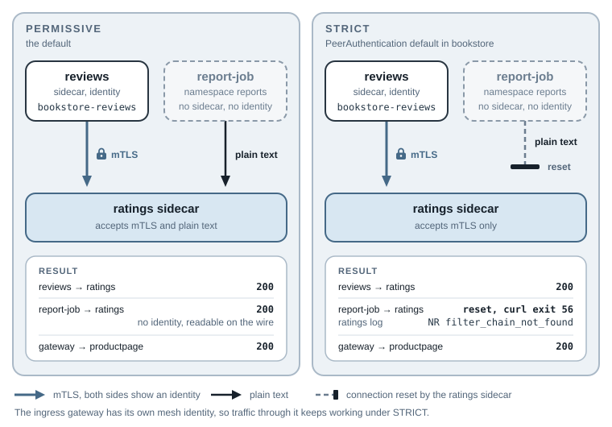

In chapter 1's fourth question, a test Pod in an unrelated namespace called `ratings` in plain
HTTP. It worked: nothing checked who the caller was, and anyone who could capture traffic on the
node network could read it. Chapter 2 fixed half of that without saying so. Since Book Store
joined the mesh, calls between its sidecars have been encrypted, with certificates nobody created
by hand. The other half is still open. The same test Pod would get in today, because Istio's
default is to accept plain text as well.

This chapter looks at what Istio set up: an identity for every workload, a certificate that
carries it, and *mutual TLS* (mTLS), where both sides of a connection prove who they are. Then it
closes the gap. A `PeerAuthentication` object set to `STRICT` makes a namespace refuse plain text.
Turning that on carelessly breaks real clients, so the chapter also shows how to find them first.

By the end of this chapter you will:

- Read a workload's identity (its SPIFFE ID) from its certificate and from the header its peer
  receives.
- Explain the difference between `PERMISSIVE` and `STRICT`, and what each accepts.
- Find the workloads that still receive plain text with one Prometheus query, and trace each one
  back to its caller.
- Switch `bookstore` to `STRICT`, see a plain-text client fail, and fix it the right way.

> **Code for this chapter.** The files are in
> [_resource/kubernetes-service-mesh/11-mtls](https://github.com/VersusControl/devops-vn-blog/tree/main/_resource/kubernetes-service-mesh/11-mtls).
> I tested them with Kind v0.33.0 (Kubernetes v1.37.0) and Istio 1.32.0 on macOS with Docker
> Desktop, and the command output in this chapter comes from those runs.

## Starting Point

Run every command from `_resource/kubernetes-service-mesh`:

```sh
export PATH="$PWD/bin:$PATH"
```

The chapter needs Book Store in the mesh, reachable at `http://bookstore.local:8080`, and
Prometheus from chapter 2. Any state from chapter 3 on works. To build it from scratch:

```sh
./scripts/bootstrap.sh 11
```

Deploy three helpers from `11-mtls/`:

- `httpbin.yaml`: `httpbin` in `bookstore`, an echo service that returns the headers it received.
- `tester.yaml`: a curl client in `bookstore`, with a sidecar.
- `outside-client.yaml`: a namespace `reports` without injection and a Pod `report-job` in it,
  with no sidecar. It stands in for a nightly report job that reads ratings.

```sh
kubectl apply -f 11-mtls/httpbin.yaml -f 11-mtls/tester.yaml -f 11-mtls/outside-client.yaml
kubectl -n bookstore rollout status deploy/httpbin
kubectl -n bookstore rollout status deploy/tester
kubectl -n reports wait --for=condition=Ready pod/report-job --timeout=90s
```

## Every Workload Has an Identity

Call `httpbin` from the tester and look at one header in the response:

```sh
kubectl -n bookstore exec deploy/tester -c tester -- \
  curl -s http://httpbin:8000/headers | grep -A2 -i "forwarded-client-cert"
```

```text
    "X-Forwarded-Client-Cert": [
      "By=spiffe://cluster.local/ns/bookstore/sa/httpbin;Hash=1e64998890bf5c109fcf8a9dd04b86778118789ce86044acfd4b46837411b23d;Subject=\"\";URI=spiffe://cluster.local/ns/bookstore/sa/tester"
    ],
```

The tester's curl sent no such header. `httpbin`'s sidecar added it after the TLS handshake with
the tester's sidecar, to tell the app who connected. (`go-httpbin` returns each header as a list,
hence the brackets.) Two identities appear in it:

- `URI=spiffe://cluster.local/ns/bookstore/sa/tester`: the client, the tester.
- `By=spiffe://cluster.local/ns/bookstore/sa/httpbin`: the server, `httpbin`.

These are *SPIFFE IDs*, a standard format for workload identity:
`spiffe://<trust domain>/ns/<namespace>/sa/<service account>`. The trust domain is
`cluster.local` by default. The rest comes from the Pod's namespace and Kubernetes service
account. That's why chapter 1 gave every Book Store service its own service account: the account
is the identity. Two Pods with the same service account have the same identity, and an IP address
plays no part in it.

Now make the same call from `report-job`, which has no sidecar:

```sh
kubectl -n reports exec report-job -- \
  curl -s http://httpbin.bookstore:8000/headers | grep -A2 -i "forwarded-client-cert"
```

`grep` prints nothing. The call itself succeeds (drop the `grep` to see the full response),
because Istio still accepts plain text, as the next sections show. But the response has no
`X-Forwarded-Client-Cert` header at all. Without a sidecar there's no certificate, so there's no
identity to report.

## Where the Certificate Comes From

The identity lives in a certificate that each sidecar holds. Show `productpage`'s:

```sh
istioctl proxy-config secret deploy/productpage-v1 -n bookstore
```

```text
RESOURCE NAME     TYPE           STATUS     VALID CERT     SERIAL NUMBER                        NOT AFTER                NOT BEFORE
default           Cert Chain     ACTIVE     true           233d5f6a503da1c49821e8b4e6aac8fa     2026-11-18T01:27:03Z     2026-11-17T01:25:03Z
ROOTCA            CA             ACTIVE     true           ffdb4b4b665f3f79e3d64934aab6906f     2036-11-14T01:04:35Z     2026-11-17T01:04:35Z
```

`default` is the workload's own certificate. `ROOTCA` is the certificate authority (CA) that
signed it, and that every sidecar trusts. They're the same two rows chapter 4 found on the
ingress gateway, next to the shop's certificate. The `ROOTCA` serial number here matches chapter
4's exactly, because one CA serves the whole mesh.

Decode `default` to see what's inside. The JSON output holds it base64-encoded; this command
extracts it with a few lines of Python and hands it to `openssl`:

```sh
istioctl proxy-config secret deploy/productpage-v1 -n bookstore -o json | python3 -c '
import base64, json, sys
for s in json.load(sys.stdin)["dynamicActiveSecrets"]:
    if s["name"] == "default":
        print(base64.b64decode(s["secret"]["tlsCertificate"]["certificateChain"]["inlineBytes"]).decode())' \
  | openssl x509 -noout -issuer -dates -ext subjectAltName
```

```text
issuer=O=cluster.local
notBefore=Nov 17 01:25:03 2026 GMT
notAfter=Nov 18 01:27:03 2026 GMT
X509v3 Subject Alternative Name: critical
    URI:spiffe://cluster.local/ns/bookstore/sa/bookstore-productpage
```

(`-ext` needs OpenSSL 3 or later. With the LibreSSL that macOS ships as `openssl`, use `-text`
and look for "Subject Alternative Name".) The output shows three things:

- **Issuer `O=cluster.local`**: `istiod` signed it. `istiod` is the mesh's CA, one of the jobs
  chapter 1 listed for it. It created its own root certificate at install time, valid for ten
  years according to the `ROOTCA` row above.
- **Valid for 24 hours**: short-lived on purpose. `istio-agent`, the process that runs next to
  Envoy in the `istio-proxy` container, asks `istiod` for a new certificate well before the old
  one expires. It hands the certificate to Envoy over SDS, the same API chapter 4 used for
  gateway certificates. Nobody rotates anything by hand, and a stolen certificate and key stop
  working within a day.
- **The SPIFFE ID is in the Subject Alternative Name**, as a URI. The subject itself is empty
  (the `Subject=""` in the header earlier), so the SAN is the certificate's only name, which is
  why it's marked `critical`. That URI is what each side checks during the handshake.


The figure follows the identity from the service account to the handshake. When `productpage`'s
sidecar calls `reviews`, it knows the destination has a sidecar (`istiod` told it), so it uses
mTLS automatically. Istio calls this *auto mTLS*. That's why traffic between sidecars has been
encrypted since chapter 2 without any configuration.

> **Note:** A root that `istiod` generates for itself is fine for a lab. In production, many
> teams give `istiod` an intermediate CA signed by their own root instead (Istio's docs call this
> plugging in CA certificates), so mesh certificates chain to a root the organization controls
> and can rotate. This series keeps the self-generated root.

## PERMISSIVE: Accept Both

If sidecars use mTLS by default, why did `report-job`'s plain-text call work? Because each sidecar
also *accepts* plain text. The mode is called `PERMISSIVE`, and it's Istio's default: a sidecar
accepts mTLS from mesh clients and plain text from everyone else. It exists so you can add Istio
to a running system one service at a time without breaking callers that don't have a sidecar yet.

To accept both, the sidecar's inbound listener looks at the first bytes of each new connection.
A TLS handshake from a mesh client goes to one filter chain, which completes mTLS; anything else
goes to a second chain that handles it as plain text. The figure shows the result for
`ratings`, and what changes under `STRICT`, the mode the rest of the chapter switches to:



The setting that changes it is a `PeerAuthentication` object, which controls what a sidecar
*accepts*. (What a sidecar *sends* is decided by auto mTLS, or by a `DestinationRule`'s `tls`
settings as in chapter 10.)

## Find the Plain-Text Callers First

Before switching anything to `STRICT`, find out who would break. Every sidecar records, for each
request it receives, whether the connection used mTLS. Prometheus collects that as the
`connection_security_policy` label on the `istio_requests_total` metric: `mutual_tls` or `none`.

Generate some plain-text traffic first. This sends ten requests from the report job to
`ratings`:

```sh
for i in $(seq 10); do
  kubectl -n reports exec report-job -- curl -s -o /dev/null http://ratings.bookstore:9080/ratings/0
done
```

Then open a second terminal, move into the same folder, and forward a local port to Prometheus.
The command holds the tunnel open until you press Ctrl+C:

```sh
kubectl -n istio-system port-forward svc/prometheus 9090:9090
```

Prometheus collects new numbers every 15 seconds, so wait about half a minute after the loop.
Back in the first terminal, ask Prometheus which `bookstore` workloads received plain text. The
query adds up requests per destination workload where `connection_security_policy` is `none`.
`reporter="destination"` selects the receiving sidecar's count, which is the only one that
exists here, because a caller without a sidecar reports nothing. The Python lines print one
result per line:

```sh
curl -s http://localhost:9090/api/v1/query --data-urlencode \
  'query=sum by (destination_workload, connection_security_policy) (istio_requests_total{reporter="destination", destination_workload_namespace="bookstore", connection_security_policy="none"})' \
  | python3 -c '
import json, sys
for r in json.load(sys.stdin)["data"]["result"]:
    m = r["metric"]
    print(m["destination_workload"], m["connection_security_policy"], r["value"][1])'
```

```text
httpbin none 1
ratings-v1 none 15
reviews-v1 none 6
reviews-v2 none 13
reviews-v3 none 11
```

The counters add up everything since each Pod started, so the list includes old traffic.
`ratings-v1` received 15 plain-text requests, all from the report job (I had sent it five more
before this loop). The `httpbin` line is the report job's call from the identity section. The
`reviews` lines came from chapter 6's test Pod in the `outside` namespace: 6, 13, and 11 are
exactly the 30 calls that chapter counted. If you bootstrapped this chapter, you'll see only
`ratings-v1` and `httpbin`.

The query names the workloads that *receive* plain text, not the callers. A caller without a
sidecar has no identity for the metric to record. To find it, read the receiving sidecar's
access log, which records each client's IP address (the next section shows such a line), and
match the IP against `kubectl get pod -A -o wide`.

In a real cluster, run the query over a longer window, so that a job that calls once a night
shows up too. Wrapping the metric in `increase(...[7d])` counts the last seven days and handles
counter resets when Pods restart. Your Prometheus must keep that much data (the add-on from
chapter 2 keeps 15 days). I didn't run that variant, because the lab has only minutes of
history. The result is the list of services whose callers need fixing before `STRICT`.

The same query with `connection_security_policy="mutual_tls"` lists the healthy side: workloads
such as `productpage` and `reviews` that receive mTLS from other sidecars and the gateway. Kiali
shows the same information as a lock icon on each graph edge when you turn on the "Security"
badge in the graph's "Display" menu.

## Switch bookstore to STRICT

`11-mtls/peerauthentication-strict.yaml`:

```yaml
apiVersion: security.istio.io/v1
kind: PeerAuthentication
metadata:
  name: default
  namespace: bookstore
spec:
  mtls:
    mode: STRICT
```

A `PeerAuthentication` named `default` with no `selector` applies to every workload in its
namespace. The same object in `istio-system`, the root namespace, would apply to the whole mesh.
Apply it, then test the three kinds of caller: the report job, Book Store through the gateway, and
the tester inside the mesh:

```sh
kubectl apply -f 11-mtls/peerauthentication-strict.yaml
kubectl -n reports exec report-job -- \
  curl -sS -o /dev/null -w "%{http_code}\n" http://ratings.bookstore:9080/ratings/0
./scripts/count-versions.sh http://bookstore.local:8080 10
kubectl -n bookstore exec deploy/tester -c tester -- \
  curl -s -o /dev/null -w "%{http_code}\n" http://ratings:9080/ratings/0
```

```text
peerauthentication.security.istio.io/default created
000
curl: (56) Recv failure: Connection reset by peer
command terminated with exit code 56
   6 200 reviews-v1 no-stars fast
   2 200 reviews-v3 stars fast
   2 200 reviews-v2 stars fast
200
```

The report job is cut off: `000` means curl got no HTTP response, and exit code 56 is the reset
connection. (`-sS` keeps curl quiet but still prints the error.) Everything with a sidecar is
unaffected. That includes the ingress gateway, which has its own mesh certificate (the `default`
row in chapter 4's output) and calls `productpage` with mTLS.

On the `ratings` side, the rejected connection appears in the sidecar's access log. A rejected
connection never becomes an HTTP request, so `grep -v '"GET'` hides the normal request lines and
`tail -1` keeps the latest of the rest:

```sh
kubectl -n bookstore logs deploy/ratings-v1 -c istio-proxy --since=2m | grep -v '"GET' | tail -1
```

```text
[2026-11-17T02:04:10.810Z] "- - -" 0 NR filter_chain_not_found - "-" 0 0 0 - "-" "-" "-" "-" "-" - - 10.244.1.18:9080 10.244.1.16:44166 - -
```

`"- - -"` means no HTTP request was read, as in chapter 10's TCP lines. `NR` is the "no route"
flag from chapter 5's table, but the detail differs from the `route_not_found` you saw there:
`filter_chain_not_found`. The connection failed one step earlier, before any HTTP routing. Compare
the inbound listener for port 9080 in `ratings`' sidecar before and after the switch:

```sh
istioctl proxy-config listener deploy/ratings-v1 -n bookstore --port 15006 | grep -E "ADDRESS|9080"
```

Under `PERMISSIVE`:

```text
ADDRESSES PORT  MATCH                                                                                           DESTINATION
0.0.0.0   15006 Trans: tls; App: istio,istio-peer-exchange,istio-http/1.0,istio-http/1.1,istio-h2; Addr: *:9080 Cluster: inbound|9080||
0.0.0.0   15006 Trans: raw_buffer; Addr: *:9080                                                                 Cluster: inbound|9080||
```

Under `STRICT`:

```text
ADDRESSES PORT  MATCH                                                   DESTINATION
0.0.0.0   15006 Trans: tls; Addr: *:9080                                Cluster: inbound|9080||
```

`Trans: raw_buffer` is the filter chain for plain text, and `STRICT` removed it. A connection that
doesn't start a TLS handshake now matches no chain, so the sidecar closes it.

The last address on the line, `10.244.1.16`, is the client's Pod IP: the report job, the caller
to go find. `istioctl x describe` confirms which policy a Pod is under:

```sh
istioctl x describe pod $(kubectl -n bookstore get pod -l app=ratings -o jsonpath='{.items[0].metadata.name}') \
  -n bookstore | grep -A1 PeerAuthentication
```

```text
Effective PeerAuthentication:
   Workload mTLS mode: STRICT
Applied PeerAuthentication:
   default.bookstore
```

The `$(...)` part looks up the name of the first `ratings` Pod. "Effective" is the mode the Pod
enforces, and "Applied" names the object it came from: `default` in `bookstore`. When several
policies could apply, this is the quickest way to see which one won.

## Two Ways to Fix the Report Job

The report job is the failure most teams hit when they turn on `STRICT`: a client nobody thought
of, in a namespace nobody injected. There are two ways out, one for the next ten minutes and one
for good.

### A temporary exception

A `PeerAuthentication` with a `selector` applies to matching workloads only, and it overrides the
namespace default. `11-mtls/peerauthentication-ratings-permissive.yaml` puts `ratings` alone back
on `PERMISSIVE`:

```yaml
apiVersion: security.istio.io/v1
kind: PeerAuthentication
metadata:
  name: ratings-permissive
  namespace: bookstore
spec:
  selector:
    matchLabels:
      app: ratings
  mtls:
    mode: PERMISSIVE
```

```sh
kubectl apply -f 11-mtls/peerauthentication-ratings-permissive.yaml
kubectl -n reports exec report-job -- curl -s -o /dev/null -w "ratings %{http_code}\n" http://ratings.bookstore:9080/ratings/0
kubectl -n reports exec report-job -- curl -sS -o /dev/null -w "httpbin %{http_code}\n" http://httpbin.bookstore:8000/get
```

```text
peerauthentication.security.istio.io/ratings-permissive created
ratings 200
httpbin 000
curl: (56) Recv failure: Connection reset by peer
command terminated with exit code 56
```

`ratings` accepts the report job again; `httpbin`, still under the namespace's `STRICT`, doesn't.
Mesh clients such as `reviews` keep using mTLS to `ratings`, because auto mTLS decides what they
send. The exception only reopens the plain-text door.

This buys time, and it's a hole: while it exists, any Pod in the cluster can call `ratings`
without an identity, and that traffic crosses the network unencrypted. Remove it once the real
fix is in:

```sh
kubectl delete -f 11-mtls/peerauthentication-ratings-permissive.yaml
```

### The real fix: give the client an identity

The report job fails because it has no sidecar, so it has no certificate. Give it one: label its
namespace for injection and recreate the Pod (chapter 2's rule: injection happens only when a Pod
is created):

```sh
kubectl label namespace reports istio-injection=enabled
kubectl -n reports delete pod report-job
kubectl apply -f 11-mtls/outside-client.yaml
kubectl -n reports wait --for=condition=Ready pod/report-job --timeout=90s
kubectl -n reports get pod report-job
kubectl -n reports exec report-job -c report-job -- \
  curl -s -o /dev/null -w "ratings %{http_code}\n" http://ratings.bookstore:9080/ratings/0
```

```text
namespace/reports labeled
pod "report-job" deleted
namespace/reports unchanged
pod/report-job created
pod/report-job condition met
NAME         READY   STATUS    RESTARTS   AGE
report-job   2/2     Running   0          3s
ratings 200
```

`namespace/reports unchanged` is expected: the manifest doesn't list the injection label, so
`kubectl apply` leaves the label you just set in place. The `exec` names the container with
`-c report-job` now that the Pod has two.

`2/2`, and the call works under `STRICT`. The app still sends plain HTTP to
`http://ratings.bookstore:9080`; its new sidecar upgrades the connection to mTLS. The Pod sets no
service account, so it runs as `default`. Call `httpbin` from it and the header shows its new
identity:

```sh
kubectl -n reports exec report-job -c report-job -- \
  curl -s http://httpbin.bookstore:8000/headers | grep -A2 -i "forwarded-client-cert"
```

```text
    "X-Forwarded-Client-Cert": [
      "By=spiffe://cluster.local/ns/bookstore/sa/httpbin;Hash=afc0746f7c76efe6ba1c24e7fb3e1c2343adbbfaeee69186ee9a9954abeb9afa;Subject=\"\";URI=spiffe://cluster.local/ns/reports/sa/default"
    ],
```

The client is `spiffe://cluster.local/ns/reports/sa/default`. Every other Pod in `reports` that doesn't name a
service account gets the same identity. That matters in chapter 12, where authorization policies
decide which identities may call which service: a real report job should get a service account
of its own, as each Book Store service has.


The figure sums up the chapter as a migration plan. The order for a real cluster:

1. Leave the mesh on `PERMISSIVE` (the default) while you add sidecars.
2. Run the plain-text query, over a window long enough to catch nightly and weekly jobs, until it
   returns nothing for the namespace. Fix each caller it finds, usually by injecting it. Callers
   that can never have a sidecar, such as a service on a VM outside the cluster, need a
   workload-level exception or a different path in, such as the ingress gateway.
3. Switch the namespace to `STRICT`. Once every namespace is done, switch the mesh with a
   `PeerAuthentication` named `default` in `istio-system`.

## Reset Before the Next Chapter

Keep `STRICT` on: chapter 12 builds authorization on top of mTLS identities. Remove the helpers:

```sh
kubectl delete -f 11-mtls/httpbin.yaml -f 11-mtls/tester.yaml
kubectl delete namespace reports
kubectl get peerauthentication -A
```

```text
...
namespace "reports" deleted
NAMESPACE   NAME      MODE     AGE
bookstore   default   STRICT   2m3s
```

The last command should list one object, `default` in `bookstore` with mode `STRICT`. If
`ratings-permissive` is still there, delete it as shown above; chapter 12 starts with only the
namespace-wide `STRICT` policy, the same state `bootstrap.sh 12` builds.

Stop the Prometheus port-forward with Ctrl+C. To rebuild the starting state of chapter 12 from
scratch: `./scripts/bootstrap.sh 12`.

## Summary

- Every workload gets a SPIFFE ID from its namespace and service account,
  `spiffe://cluster.local/ns/<namespace>/sa/<account>`, in a 24-hour certificate that `istiod`
  signs and the sidecar renews.
- Sidecars use mTLS with each other automatically (auto mTLS). By default they also accept plain
  text (`PERMISSIVE`), so clients without a sidecar keep working and carry no identity.
- `istio_requests_total{connection_security_policy="none"}` in Prometheus lists every workload that
  still receives plain text. The receiving sidecar's access log gives each caller's IP. Fix those
  callers before `STRICT`.
- A `PeerAuthentication` with `mode: STRICT` rejects plain text (`NR filter_chain_not_found` in the
  log). A workload-level `PERMISSIVE` with a `selector` is a temporary exception; injecting the
  client is the fix.
- Next, chapter 12 uses these identities to decide who may call whom, and adds JWT checks at the
  gateway.
